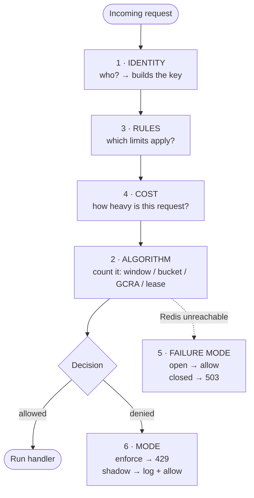
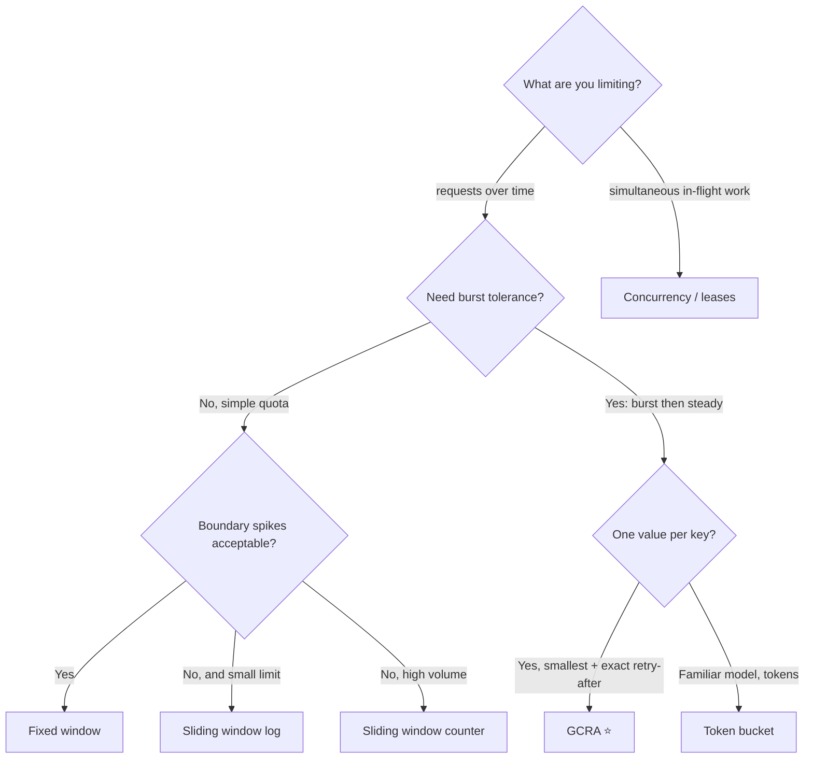
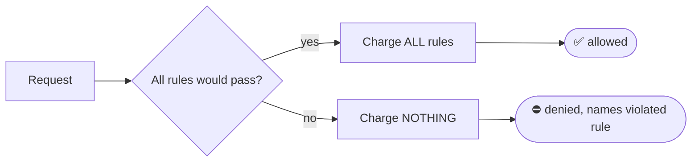
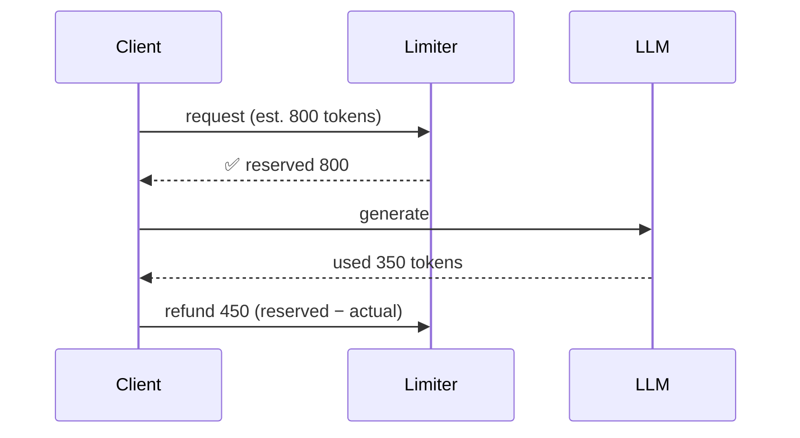
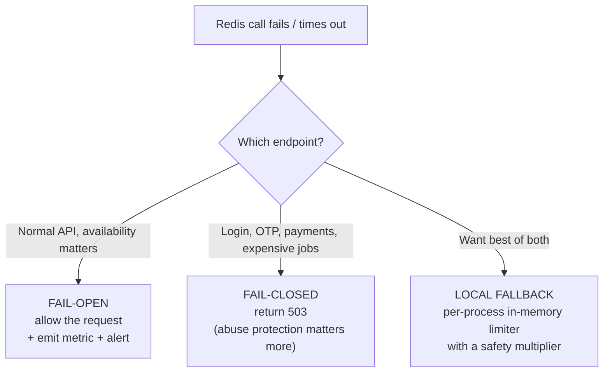
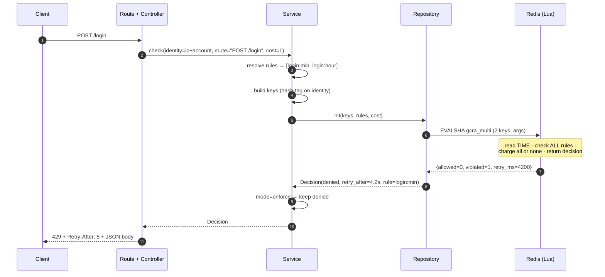

# 01 · The Axes of a Rate Limiter, and the Architecture That Holds Them

> **Read this first.** Every rate limiter in this repo is a point in a six-dimensional space. Once you can name your point, you know which folder to open.
> Time to read: ~25 minutes.

---

## Table of contents

1. [What rate limiting is (and the doorman analogy)](#1-what-rate-limiting-is)
2. [The six axes at a glance](#2-the-six-axes-at-a-glance)
3. [Axis 1: Identity: *who* is being limited](#3-axis-1-identity)
4. [Axis 2: Algorithm: *how* we count](#4-axis-2-algorithm)
5. [Axis 3: Rules per request: *how many limits at once*](#5-axis-3-rules-per-request)
6. [Axis 4: Cost: *how much one request weighs*](#6-axis-4-cost)
7. [Axis 5: Failure mode: *what if the limiter breaks*](#7-axis-5-failure-mode)
8. [Axis 6: Mode: *enforce, observe, or bypass*](#8-axis-6-mode)
9. [Putting the axes together: four spec sheets](#9-putting-the-axes-together)
10. [Architecture](#10-architecture)

---

## 1. What rate limiting is

A **rate limiter** answers one question, thousands of times per second:

> *"Should I let **this caller** do **this thing** **right now**?"*

**The doorman analogy.** A club has a doorman with a clipboard.

```text
        ┌───────────────┐
 Alice ─►   DOORMAN      │──► ✅ "Come in"
 Alice ─►  (clipboard =  │──► ✅ "Come in"
 Alice ─►   Redis)       │──► ⛔ "Too many visits tonight. Come back in 20 minutes."
        └───────────────┘
```

Every design decision is about the doorman:

| Doorman question | Axis |
|---|---|
| *Who is this person?* (face? ticket? company badge?) | **Identity** |
| *How do I count visits?* (tally marks? stopwatch? wristbands?) | **Algorithm** |
| *Is there more than one rule?* ("3 per hour AND 10 per night") | **Rules per request** |
| *Do some guests count double?* (groups, VIP rooms) | **Cost** |
| *What if my clipboard is lost?* (let everyone in? lock the door?) | **Failure mode** |
| *Am I enforcing yet, or just taking notes?* | **Mode** |

**Why bother?** Real incidents each rate limit prevents:

| Problem | Example | Rate limiting's role |
|---|---|---|
| Brute force | 1M password guesses against `/login` | Caps guesses per account/IP |
| Noisy neighbour | One tenant's script hammers a shared API | Protects other tenants |
| Cost blow-up | A bug loops calling your LLM endpoint | Caps spend |
| Scraping | Bot pulls your whole catalogue | Caps throughput |
| Self-DDoS | Your own client retries in a tight loop | Back-pressure |

---

## 2. The six axes at a glance



| # | Axis | Question | Typical values | Repo folder |
|---|---|---|---|---|
| 1 | **Identity** | Who is limited? | IP, user, API key, tenant, endpoint, global, **IP+user**, hierarchy | `policies/02_identity_strategies` |
| 2 | **Algorithm** | How is usage counted? | fixed window, sliding log, sliding counter, token bucket, GCRA, concurrency | `algorithms/01…06` |
| 3 | **Rules** | How many limits per request? | one, or several enforced together | `policies/01_multi_rule` |
| 4 | **Cost** | How much does one request consume? | 1, weighted, post-hoc (tokens) | `policies/03_weighted_cost` |
| 5 | **Failure mode** | Redis is down. Now what? | fail-open, fail-closed, local fallback | `policies/04_failure_modes` |
| 6 | **Mode** | Enforce or observe? | enforce, shadow, allowlist | `policies/05_shadow_mode` |

---

## 3. Axis 1: Identity

> **The identity is the string that decides whose bucket you are in.** It becomes part of the Redis key.

```text
rl:{user:42}:api:min
    └──────┘ └─────┘
   identity   rule name
```

### 3.1 The identity types

| Identity | Key example | Best for | Watch out for |
|---|---|---|---|
| **IP address** | `rl:{ip:203.0.113.7}:api` | Anonymous traffic, login pages, signup | Shared IPs (offices, mobile carriers, NAT) punish innocents; IPv6 users can rotate addresses within a /64, so prefer limiting by /64 prefix |
| **User ID** | `rl:{user:42}:api` | Logged-in apps | Needs authentication *before* limiting, so unauthenticated floods bypass it |
| **API key** | `rl:{key:sk_live_ab12}:api` | Public/partner APIs with plans | Leaked key = shared quota; store a hash of the key, not the raw key, in Redis |
| **Tenant / org** | `rl:{tenant:acme}:api` | B2B SaaS fairness | One heavy user can starve their colleagues (combine with a per-user limit) |
| **Endpoint** | `rl:{user:42}:POST:/export` | Protecting expensive routes | Many routes → many keys; define per-route policy in config |
| **Global** | `rl:{global}:search-backend` | Protecting a downstream with a hard cap (e.g. a partner API allowing 100 rps) | ⚠️ **Hot key**: all traffic hits one key (one Redis slot). Fine for a few thousand RPS, a bottleneck beyond |
| **Device / fingerprint** | `rl:{device:ab12}:otp` | Fraud, OTP abuse | Spoofable; use as an *additional* identity |
| **Dual key (IP + user)** | `rl:{ip:1.2.3.4\|user:42}:login` | Login, either as one composite bucket or as two buckets that must both pass | The two approaches catch different attacks. See 3.3 |
| **Hierarchy** | global → tenant → user | Multi-tenant SaaS | Atomicity across levels (see 3.4) |

### 3.2 Scenario: the shared-IP trap

> **Setup:** You limit `/login` to 10 attempts per minute **per IP**.
> **Incident:** A university with 5,000 students shares one public IP behind NAT. At 9:00 AM class starts, everyone logs in. After the 10th student, the other 4,990 are blocked.

```text
IP 198.51.100.9  (university NAT)
 ├── student 1  ✅
 ├── ...
 ├── student 10 ✅
 └── student 11..5000  ⛔ "Too many attempts"   ← collateral damage
```

**Fix:** use IP as a *loose* limit (e.g. 600/min) and add a *tight* limit on a more specific identity (per **account being attacked**, per **user+IP** pair). That's why dual-key and multi-identity exist.

### 3.3 Dual key: IP + user (in detail)

You can combine two identities in two different ways. **They are not the same thing:**

| Approach | How | What it catches | What it misses |
|---|---|---|---|
| **A. Composite key**: one bucket for the pair | `rl:{ip:1.2.3.4\|user:42}:login` | The same person hammering one account from one IP | Attacker rotating IPs against one account (every IP gets a fresh bucket!) |
| **B. Two separate buckets, both must pass** | `rl:{ip:1.2.3.4}:login` **and** `rl:{user:42}:login` | Both attacks: one IP hitting many accounts, many IPs hitting one account | Needs two keys, which raises the cluster question below |

**Scenario: credential stuffing.** An attacker has a list of 10,000 leaked passwords for `alice@example.com` and a botnet of 1,000 IPs.

```text
Composite key (A)                         Two buckets (B)
─────────────────                         ───────────────
bot IP #1 → bucket(ip1,alice)  ✅ 5       bot IP #1 ┐
bot IP #2 → bucket(ip2,alice)  ✅ 5                 ├─► bucket(alice): 5 total ⛔ after 5
bot IP #3 → bucket(ip3,alice)  ✅ 5       bot IP #2 ┘
...1,000 IPs × 5 = 5,000 guesses ❌       ...whole botnet shares ONE budget for alice ✅
```

**Verdict:** for login protection use **approach B** with per-account (tight), per-IP (loose) limits, and optionally the composite as a third rule.

**The cluster question.** In Redis Cluster, a Lua script may only touch keys in the **same hash slot**. Keys are placed by the text inside `{...}`:

```text
rl:{ip:1.2.3.4}:login   ──► slot 4172
rl:{user:42}:login      ──► slot 9015     ← different slot: ONE script cannot check both
```

Your options:

| Option | How | Trade-off |
|---|---|---|
| **1. Share a hash tag** | `rl:{login}:ip:1.2.3.4` and `rl:{login}:user:42` | Atomic across both. ⚠️ All login traffic lands on **one slot** (hot shard) |
| **2. Two script calls, check both** | Call per identity; if the second denies, refund the first | Not atomic. Tiny window for over-count. No hot slot |
| **3. Non-cluster Redis** | Single primary (+ replicas) | Everything is one slot. Easiest. Scales to a lot more than most apps need |

Repo guidance: **start with option 3 or 2.** Pick option 1 only for low-volume, high-value endpoints (login, OTP) where one hot slot is irrelevant.

### 3.4 Hierarchy: global → tenant → user

```text
              ┌─────────────────────────────┐
              │ GLOBAL      10,000 req/s    │   protects your infrastructure
              └──────────────┬──────────────┘
                 ┌───────────┴───────────┐
        ┌────────▼────────┐     ┌────────▼────────┐
        │ TENANT acme     │     │ TENANT globex   │      fairness between customers
        │  1,000 req/s    │     │  200 req/s      │
        └───┬─────────┬───┘     └─────────────────┘
       ┌────▼───┐ ┌───▼────┐
       │ user 1 │ │ user 2 │   50 req/s each                stops one user hogging the tenant
       └────────┘ └────────┘
```

A request must pass **all three levels**. Implementation is "multi-rule" (axis 3) across three identities.

### 3.5 Scenario: anonymous → authenticated

A visitor hits your API anonymously (identity = IP), logs in, and continues (identity = user). If those are different buckets:

```text
t=0   anonymous  ip:1.2.3.4   uses 4/5 of anonymous bucket
t=1   logs in →  user:42      fresh bucket, 5/5 available   ← budget "reset" by logging in
```

If that matters (e.g. an expensive endpoint), apply the **IP limit always** and the **user limit additionally** once authenticated.

### 3.6 Trusting the IP: the `X-Forwarded-For` trap

Behind a load balancer, the TCP peer IP is the *proxy's*. You read the client IP from `X-Forwarded-For`, but **clients can send that header themselves**.

```text
Attacker sends:   X-Forwarded-For: 1.1.1.1          ← forged
Load balancer appends real IP:   X-Forwarded-For: 1.1.1.1, 203.0.113.50
```

Rule: only trust the entries added **by your own proxies** (count from the right by the number of trusted hops). Never take the left-most value blindly, or an attacker gets a new identity per request.

---

## 4. Axis 2: Algorithm

The algorithm decides **how usage is counted over time**. This is the deepest axis, so it has its own document: [`02-algorithms.md`](02-algorithms.md).

Quick map:



---

## 5. Axis 3: Rules per request

One endpoint often needs **several limits at the same time**, each covering a different time scale.

### 5.1 Why several rules?

| Rule | Protects against |
|---|---|
| `5 per second` | Bursts / script hammering |
| `100 per hour` | Sustained scraping |
| `1,000 per day` | Quota abuse |

A single "100 per hour" rule lets an attacker spend all 100 in the first second. A single "5 per second" rule lets them do 18,000 per hour. **You need both.**

### 5.2 The all-or-nothing problem

Say a request is checked against 3 rules **one by one** and consumes quota as it goes:

```text
Request arrives. Rules: [sec: 5/s] [hour: 100/h] [day: 1000/d]

Check sec   → ✅ consumes 1 from sec     (sec: 4 left)
Check hour  → ✅ consumes 1 from hour    (hour: 99 left)
Check day   → ⛔ day exhausted!

Result: request DENIED, but sec and hour were already charged.
        → The user was billed twice for a request that never ran.
```

Repeat that a few hundred times and a user who is *already* blocked by the daily rule **drains their per-second and hourly budgets**, so when the day resets they're still blocked. This is **quota burn**.

**Correct behaviour (atomic all-or-nothing):**

```text
Check sec   → would pass    (don't charge yet)
Check hour  → would pass    (don't charge yet)
Check day   → would FAIL
                 ↓
         Deny. Charge NOTHING.
```



This is why the multi-rule limiter is a **single Lua script** that receives all keys at once (see doc 03).

### 5.3 What the response should say

| Field | Value when multiple rules deny |
|---|---|
| `violated_rule` | The rule with the **longest wait** (the one that actually blocks the caller) |
| `Retry-After` | The **maximum** wait across denying rules. Retrying earlier would be denied again |

### 5.4 Example: a plan table as data

```yaml
plans:
  free:
    rules:
      - { name: api:sec,  limit: 5,    period: 1s,    burst: 10 }
      - { name: api:hour, limit: 500,  period: 1h }
  pro:
    rules:
      - { name: api:sec,  limit: 50,   period: 1s,    burst: 100 }
      - { name: api:hour, limit: 20000, period: 1h }
routes:
  "POST /login":
    identity: [ip, account]
    rules:
      - { name: login:min,  limit: 5,  period: 1m }
      - { name: login:hour, limit: 20, period: 1h }
```

Rules are **data, not code**. Changing a plan should not need a deploy.

---

## 6. Axis 4: Cost

By default one request costs **1**. Real systems need heavier requests to cost more.

### 6.1 Static weights

| Endpoint | Cost | Why |
|---|---|---|
| `GET /items/{id}` | 1 | Cheap cache hit |
| `GET /search?q=` | 5 | Hits search cluster |
| `POST /reports/export` | 50 | Generates a big file |

With a budget of 100 cost/minute: 100 gets, **or** 20 searches, **or** 2 exports.

```text
Budget: 100 units per minute          cost per call
────────────────────────────────────────────────────
GET  item     ■                        1
GET  search   ■■■■■                    5
POST export   ■■■■■■■■■■…(50)          50
```

### 6.2 Dynamic cost: LLM tokens (cost known only *after* the call)

You can't know how many tokens a response will use before generating it.



Pattern: **reserve an estimate up front → run → settle the difference.** If actual is *more* than the estimate, charge the extra (it may push the caller slightly negative, which is fine; they just wait longer next time).

### 6.3 The impossible request

If `cost > burst capacity`, **no amount of waiting will ever allow it**. Example: capacity 10, request costs 50.

| Wrong | Right |
|---|---|
| `429 Retry-After: 30`, client retries forever | `400/422` "request exceeds maximum allowed size", **never retryable** |

---

## 7. Axis 5: Failure mode

The limiter depends on Redis. **Redis will eventually be unreachable** (deploy, network blip, failover). Decide **in advance** what to do.



| Mode | Behaviour when Redis is down | Risk | Use for |
|---|---|---|---|
| **Fail-open** | Everyone allowed | Abuse window during outage | Read APIs, public content |
| **Fail-closed** | Everyone blocked (503) | **You turn a limiter outage into a full outage** | Login, OTP, SMS sending, expensive endpoints |
| **Local fallback** | Each app instance enforces its own in-memory limit (e.g. `limit / instances × 1.5`) | Approximate, inconsistent across instances | The sensible default for most APIs |

**Scenario:** Redis fails over for 20 seconds at peak.

```text
Fail-open on /api/items:     20s of unlimited traffic        → tolerable
Fail-closed on /login:       20s of "try again later"        → tolerable, and no brute force during the gap
Fail-closed on /api/items:   20s of total site outage        → ❌ you made it worse
```

Always set a **short Redis timeout** (tens of milliseconds, not seconds). A slow limiter is worse than a failed limiter, because every request waits.

---

## 8. Axis 6: Mode

| Mode | Denied request gets | Use for |
|---|---|---|
| **Enforce** | `429` | Normal production |
| **Shadow** (a.k.a. dry-run) | `200`, but a log line + metric `shadow_denied` | Rolling out a **new** limit safely |
| **Allowlist / bypass** | Skips the limiter entirely | Health checks, internal services, trusted partners |

**Rollout story.** You want to add `100 req/min` on `/search`. You don't know whether real users exceed that.

```text
Week 1  shadow  → dashboard: "3.2% of requests WOULD have been denied, mostly 2 customers"
Week 1          → you contact those 2 customers, raise their plan
Week 2  shadow  → "0.1% would be denied"
Week 3  enforce → ship with confidence
```

Without shadow mode, week 3 is a surprise outage for your biggest customers.

---

## 9. Putting the axes together

Four real configurations, written as "spec sheets". This is exactly the thinking a developer does before choosing a folder.

### Spec 1: Public REST API with plans

| Axis | Choice |
|---|---|
| Identity | API key (+ IP as a loose backstop for unauthenticated requests) |
| Algorithm | **GCRA** (smooth, exact `Retry-After`) |
| Rules | `sec` burst + `hour` quota (per plan) |
| Cost | 1 (some heavy endpoints 5) |
| Failure mode | Local fallback |
| Mode | Shadow first, then enforce |
| **Folders** | `05_gcra` + `01_multi_rule` + `02_identity_strategies` + `03_weighted_cost` + `04_failure_modes` + `05_shadow_mode` |

### Spec 2: Login endpoint

| Axis | Choice |
|---|---|
| Identity | Per **account** (tight) + per **IP** (loose), two buckets |
| Algorithm | Sliding window log (exact, tiny limit) or GCRA |
| Rules | `5/min` + `20/hour` per account |
| Cost | 1 |
| Failure mode | **Fail-closed** |
| Mode | Enforce |
| **Folders** | `02_sliding_window_log` or `05_gcra`, + `01_multi_rule` + `02_identity_strategies` + `04_failure_modes` |

### Spec 3: LLM chat endpoint

| Axis | Choice |
|---|---|
| Identity | User (+ tenant hierarchy for budgets) |
| Algorithm | Token bucket / GCRA **and** concurrency (max 2 streams at once) |
| Rules | tokens/min + tokens/day |
| Cost | Estimated tokens, refunded after |
| Failure mode | Fail-closed (cost protection) |
| Mode | Enforce |
| **Folders** | `04_token_bucket` or `05_gcra` + `06_concurrency` + `03_weighted_cost` + `04_failure_modes` |

### Spec 4: File upload / report generator

| Axis | Choice |
|---|---|
| Identity | User |
| Algorithm | **Concurrency** (max 3 jobs in flight) + GCRA (max 20/hour) |
| Rules | in-flight ≤ 3 AND rate ≤ 20/hour |
| Cost | 1 per job |
| Failure mode | Fail-closed (jobs are expensive) |
| Mode | Enforce |
| **Folders** | `06_concurrency` + `05_gcra` + `04_failure_modes` |

---

## 10. Architecture

### 10.1 The layers

```text
 ┌──────────────────────────────────────────────────────────────────────────┐
 │ TRANSPORT    FastAPI route / dependency / middleware                      │
 │              • extracts request data • returns 200/429/503 + headers      │
 └───────────────────────────────┬──────────────────────────────────────────┘
                                 ▼
 ┌──────────────────────────────────────────────────────────────────────────┐
 │ CONTROLLER   turns an HTTP request into (identity, route, cost)           │
 │              turns a Decision back into HTTP                               │
 └───────────────────────────────┬──────────────────────────────────────────┘
                                 ▼
 ┌──────────────────────────────────────────────────────────────────────────┐
 │ SERVICE      ① resolve policy → [Rule, Rule, …]     (config / plan)        │
 │ (pure logic) ② build keys   → rl:{user:42}:api:sec                         │
 │              ③ apply mode   → enforce / shadow / allowlist                 │
 │              ④ apply failure mode on repository error                      │
 └───────────────────────────────┬──────────────────────────────────────────┘
                                 ▼
 ┌──────────────────────────────────────────────────────────────────────────┐
 │ REPOSITORY   loads Lua once → EVALSHA(keys, args) → parses the reply       │
 └───────────────────────────────┬──────────────────────────────────────────┘
                                 ▼
 ┌──────────────────────────────────────────────────────────────────────────┐
 │ REDIS        state (strings/hashes/zsets) + atomic script execution        │
 └──────────────────────────────────────────────────────────────────────────┘
```

**Rule of thumb:** each layer talks only to the one directly below it. If a route imports `redis`, something is wrong.

### 10.2 Request lifecycle



### 10.3 What lives where (the most important table)

| Concern | Lives in | Why there |
|---|---|---|
| Counters, timestamps, leases | **Redis** | Shared by every app instance |
| The allow/deny *decision* | **Lua inside Redis** (or a single Redis command) | Must be atomic with the state update |
| Rule definitions, plans, overrides | **App config / DB** (cached in-process) | Data, changed without redeploying Redis |
| Key naming, identity extraction | **Service** | Policy, easy to unit test with no Redis |
| 429/503, headers | **Controller / route** | HTTP is a transport detail |
| Fail-open/closed, shadow, allowlist | **Service** | Application policy, not algorithm |
| Metrics, logs | **Service + controller** | Observability of decisions |

### 10.4 The Decision contract

Every algorithm in this repo returns the same shape, so you can swap algorithms without touching routes:

```python
@dataclass(frozen=True)
class Decision:
    allowed: bool
    remaining: int          # how many more units right now
    retry_after_s: float    # 0 if allowed; else how long to wait
    reset_s: float          # time until fully replenished
    limit: int              # for headers
    violated_rule: str | None
    outcome: str            # allowed | denied | shadow_denied | fail_open | bypassed
```

### 10.5 Key naming

```text
rl : { identity } : rule : [suffix]
│    │            │       │
│    │            │       └ algorithm detail (e.g. window id for fixed window)
│    │            └──────── which limit  (login:min)
│    └───────────────────── hash tag = identity ONLY (cluster slot)
└────────────────────────── namespace so you can SCAN/clean rl:* safely
```

Examples: `rl:{user:42}:api:sec` · `rl:{ip:203.0.113.7}:login:hour` · `rl:{user:42}:uploads:leases`

### 10.6 Observability contract

Minimum metrics every deployment needs:

| Metric | Labels | Alert when |
|---|---|---|
| `rl_decisions_total` | `limiter, rule, outcome` | `denied` spikes (attack or bad limit) |
| `rl_decisions_total{outcome="fail_open"}` | | **> 0** for more than a minute (Redis trouble) |
| `rl_latency_seconds` | `limiter` | p99 > 10 ms (limiter adds noticeable latency) |
| `rl_shadow_denied_total` | `rule` | informational during rollouts |

### 10.7 Where to go next

* Algorithms in depth → [`02-algorithms.md`](02-algorithms.md)
* Why Lua, when client, production checklist → [`03-lua-vs-client-and-production.md`](03-lua-vs-client-and-production.md)
