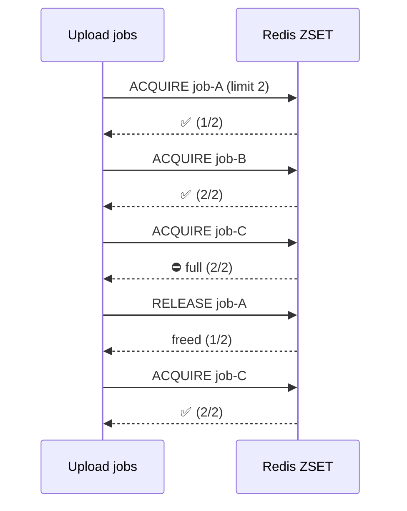
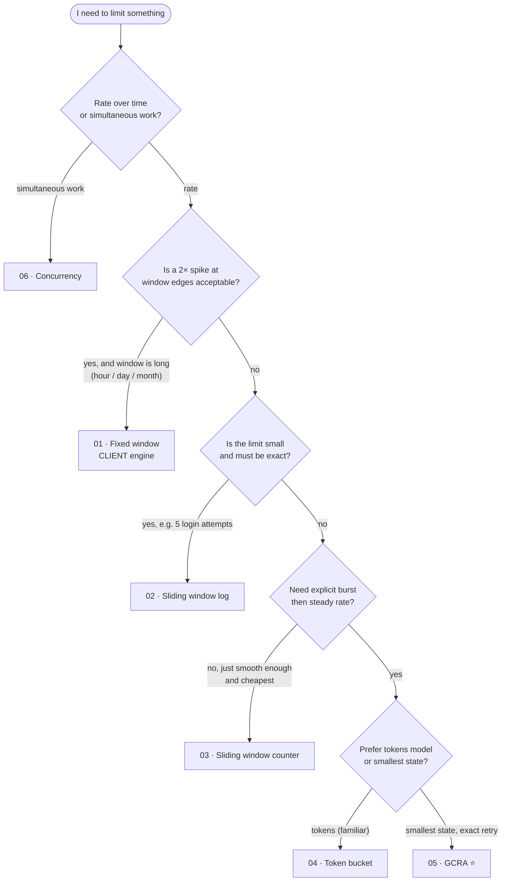

# 02 · Rate Limiting Algorithms: How Each One Works, and When to Use It

> You do **not** need to read Lua or Redis code for this document. Every algorithm is explained with pictures of **what Redis stores** and **how that data changes**, one request at a time.
> Time to read: ~35 minutes.

---

## Table of contents

1. [The shared scenario](#1-the-shared-scenario)
2. [Fixed window](#2-fixed-window)
3. [Sliding window log](#3-sliding-window-log)
4. [Sliding window counter](#4-sliding-window-counter)
5. [Token bucket](#5-token-bucket)
6. [GCRA](#6-gcra-generic-cell-rate-algorithm)
7. [Concurrency limiter (leases)](#7-concurrency-limiter-leases)
8. [Side-by-side comparison](#8-side-by-side-comparison)
9. [Decision flowchart](#9-decision-flowchart)
10. [Common pitfalls](#10-common-pitfalls)

---

## 1. The shared scenario

To compare fairly, every algorithm is shown on the same story:

> **Alice** calls your API. You want to allow her about **5 requests per 10 seconds**.

Legend used in every diagram:

```text
✅  allowed        ⛔  denied        t=…  seconds since start
[ ] empty slot     [■] used slot
```

What does "5 per 10 seconds" actually mean? That turns out to be a design choice, and each algorithm answers it differently.

---

## 2. Fixed window

### The idea

Chop time into fixed boxes (0 to 10 s, 10 to 20 s, …). Keep **one counter per box**. Reset when a new box starts.

*Analogy: a doorman with a clicker who resets it to zero on the hour, every hour.*

### What Redis stores

One small number per (user, window):

```text
KEY                           VALUE   TTL
rl:{alice}:api:fw:171          3       7s      ← window #171 (10-second box), Alice has used 3
```

The window number is `floor(now / 10s)`. The key **expires on its own** when the window ends.

### How it works, step by step

```text
Window #0: t = 0 … 10        Window #1: t = 10 … 20
├────────────────────────┤   ├────────────────────────┤
 t=1  ✅  counter=1
 t=2  ✅  counter=2
 t=3  ✅  counter=3
 t=4  ✅  counter=4
 t=5  ✅  counter=5
 t=6  ⛔  counter=5 → limit reached
 t=9  ⛔
                              t=10 ✅  new window, counter=1
```

Each request does: *add 1 to the counter; if the result is ≤ 5, allow.*

### The famous flaw: the boundary spike

```text
 limit: 5 per 10s

 window #0 (t=0…10)                 window #1 (t=10…20)
 ├──────────────────────────■■■■■┤├■■■■■──────────────────────────┤
                         t=9.0 … 9.9  t=10.0 … 10.9
                         └──── 10 requests in ~2 seconds ────┘
                                 ✅ ✅ ✅ ✅ ✅ | ✅ ✅ ✅ ✅ ✅
```

Both windows are individually within the limit, yet Alice made **10 requests in about 1 second**, which is **2× the intended rate**.

| | |
|---|---|
| **Memory** | 1 small key per active user per window |
| **Accuracy** | Poor at window edges (up to 2× burst) |
| **Burst handling** | None / accidental |
| **Retry-After** | Time until the window ends (coarse) |

### Use it when

* Quotas where precision at edges doesn't matter: **"1,000 emails per day"**, **"10,000 API calls per month"**
* You want the simplest, cheapest, most debuggable thing possible
* The window is long (hour/day) so a 2× edge spike is not a real risk

### Avoid it when

* Short windows protecting a fragile backend (a 2× spike hurts)
* You need to explain to a customer exactly why they were blocked

### Engine

**Client**: `INCR` returns the new count in one command (see doc 03, Rule 1).

---

## 3. Sliding window log

### The idea

Instead of a counter, keep a **diary of every request's timestamp** in the last 10 seconds. To decide, count the diary entries. Throw away entries older than 10 s.

*Analogy: a doorman who writes each guest's arrival time on a list and crosses out lines older than 10 minutes.*

### What Redis stores

A **sorted set (ZSET)**: a list of `member` (unique id) sorted by `score` (here, timestamp in ms).

```text
KEY  rl:{alice}:login:log                (type: ZSET)

  score (timestamp ms)   member (request id)
  ─────────────────────  ───────────────────
        1 000            req-a1
        4 000            req-a2
        8 000            req-a3
```

### How it works, step by step

Limit: **3 per 10 s** (smaller so the picture fits).

```text
Now = 11.0s. Window = (now − 10s, now] = (1.0s, 11.0s]

 BEFORE                                  STEP 1: drop entries ≤ 1.0s
 1.0  req-a1                              ──────────────────────────
 4.0  req-a2         ──────────────►      4.0  req-a2
 8.0  req-a3                              8.0  req-a3

 STEP 2: count = 2.   2 < limit(3)?  yes  → ✅
 STEP 3: add 11.0  req-a4

 AFTER
 4.0  req-a2
 8.0  req-a3
 11.0 req-a4       ← now full (3). Next request before t=14.0 is ⛔
```

Timeline view:

```text
time:   0    2    4    6    8    10   12   14
        │    │    │    │    │    │    │    │
log:    1.0       4.0       8.0   11.0
              window slides  ◄────────10s────────►
 t=11.5 request:  entries in (1.5, 11.5] = {4.0, 8.0, 11.0} = 3  → ⛔
 Retry-After = oldest(4.0) + 10 − now(11.5) = 2.5s   ← exact!
```

### Why denied requests must NOT be logged

If you always add the request to the diary first and *then* count:

```text
Alice is blocked (3/3). She keeps retrying every second.
 t=12 ⛔ (added to log anyway)  → log now 4 entries
 t=13 ⛔ (added)                → log now 5 entries
 ...
She is punished for the retries themselves and can never recover while she keeps trying.
```

So the correct order is **count → decide → add only if allowed**. That is a *read-then-conditionally-write*, which needs atomicity (doc 03 Rule 2).

| | |
|---|---|
| **Memory** | O(limit) entries per user. 3 for login, but 10,000 for "10k/hour" ⚠️ |
| **Accuracy** | **Exact** |
| **Burst handling** | Exact (no boundary spike) |
| **Retry-After** | Exact |

### Use it when

* The limit is **small** and exactness matters: login attempts (5/min), OTP sends (3/hour), password resets
* You need exact audit semantics ("never more than 5 in *any* 60 s window")

### Avoid it when

* The limit is large (memory = limit × users)
* Very high request rates (ZSET operations cost O(log n))

### Engine

**Lua**: clean + count + conditional add must be atomic (Rule 2).

---

## 4. Sliding window counter

### The idea

A cheap approximation of the log. Keep **two counters**: the *previous* window and the *current* window. Estimate the sliding window by blending them.

*Analogy: you don't remember every guest, only "last hour we had 84, this hour so far 36", and you assume the last hour's guests were evenly spread.*

### What Redis stores

```text
KEY                          VALUE
rl:{alice}:api:w:170         84      ← previous window
rl:{alice}:api:w:171         36      ← current window
```

### The formula

```text
estimated = previous × (portion of previous window still inside the sliding window)  +  current

portion still inside = 1 − (time elapsed in current window / window length)
```

### Worked example

Limit **100 per minute**. Now is **15 s into** the current minute.

```text
       previous minute (84)               current minute (36)
 ├──────────────────────────────────┤├─────────┬────────────────────────┤
                                       ▲
                                       now (15s in = 25% elapsed)

 sliding window = last 60s = [ last 45s of previous | first 15s of current ]
                              └──── 75% of previous ────┘

 estimated = 84 × 0.75 + 36 = 63 + 36 = 99
 request:  99 + 1 = 100 ≤ 100  → ✅  (counter becomes 37)
 next one: ~100 + 1 > 100       → ⛔
```

| | |
|---|---|
| **Memory** | O(1): two tiny counters |
| **Accuracy** | Approximate; it assumes the previous window's traffic was evenly spread. Real-world error is small for typical traffic |
| **Burst handling** | Much better than fixed window; no 2× edge spike |
| **Retry-After** | Approximate |

### Use it when

* High-volume APIs where the log's memory/CPU is too much
* "Good enough" accuracy is fine (you're not billing per request)

### Avoid it when

* You need exact guarantees (use log)
* You need explicit burst allowance (use token bucket/GCRA)

### Engine

**Lua**: reads two keys, computes, then conditionally increments (Rule 2).

---

## 5. Token bucket

### The idea

Alice has a **bucket that holds up to B tokens**. Every request **takes a token**. The bucket **refills at a steady rate**. Empty bucket → denied.

*Analogy: a bucket under a slowly dripping tap. You can grab several handfuls at once (burst) until it's empty, then you wait for the drip.*

```text
        💧 refill: 2 tokens / second
         │
   ┌─────▼─────┐   capacity B = 4
   │ ● ● ● ●   │   ◄── each request removes one ●
   └───────────┘
   If empty → ⛔ wait for the drip
```

### What Redis stores

A **hash** (a small record with named fields):

```text
KEY  rl:{alice}:api:tb                 (type: HASH)
   tokens : 3.0            ← how many tokens she had at last_ts
   last_ts: 1714000000500  ← when we last updated it (ms)
```

We do **not** run a timer adding tokens. We calculate the refill **lazily** when the next request comes in:

```text
tokens_now = min( capacity,  tokens + (now − last_ts) × refill_rate )
```

### Worked example

Config: **refill 2 tokens/s, capacity 4**. Alice starts full.

| Time | Request | Tokens before (after lazy refill) | Decision | Tokens after |
|---|---|---|---|---|
| 0.00 | #1 | 4.0 | ✅ | 3.0 |
| 0.00 | #2 | 3.0 | ✅ | 2.0 |
| 0.00 | #3 | 2.0 | ✅ | 1.0 |
| 0.00 | #4 | 1.0 | ✅ | 0.0 |
| 0.00 | #5 | 0.0 | ⛔ (retry in 0.5 s) | 0.0 |
| 0.50 | #6 | 0 + 0.5×2 = 1.0 | ✅ | 0.0 |
| 5.00 | #7 | min(4, 0 + 4.5×2) = **4.0** (capped) | ✅ | 3.0 |

Two key behaviours:

1. **Burst:** 4 requests at t=0 are fine (that's the capacity).
2. **Long idle doesn't hoard:** after 5 s idle, she has 4 tokens, not 10 (capacity cap).

```text
tokens
 4 │●━━●                              ●
 3 │    ●
 2 │      ●          (requests drain it quickly, refill is slow)
 1 │        ●
 0 │          ●━━━━━●                  
   └───────────────────────────────────► time
   t=0                0.5             5.0
```

| | |
|---|---|
| **Memory** | O(1): one hash with 2 fields |
| **Accuracy** | Exact |
| **Burst handling** | **Explicit**: capacity = max burst; refill = sustained rate |
| **Retry-After** | `(needed − tokens) / refill_rate` |

### Use it when

* You want to allow short bursts but cap the average rate (most public APIs)
* Your product language is "N requests per second, burst up to M"
* You want a model product people already know

### Avoid it when

* You need *exact* "never more than N in any window" semantics (use the log)
* You want the smallest possible state (GCRA stores one value)

### Engine

**Lua**: read-modify-write on two fields (Rule 2).

---

## 6. GCRA (Generic Cell Rate Algorithm)

### The idea

GCRA is **token bucket in disguise, but stores a single number** instead of two. That number is the **TAT**, the *Theoretical Arrival Time*: the earliest moment Alice will be "all caught up".

*Analogy: a ticket machine that keeps a single "next free time" timestamp. Each request pushes that time forward by one "slot". You can run ahead of the clock only by a limited amount (the burst).*

Three quantities (all in time units, so there's no refilling math):

```text
T   = emission interval = period / limit            "one request 'costs' T of time"
τ   = burst tolerance   = T × burst                 "how far ahead of the clock we may run"
TAT = the single value stored in Redis              "when Alice is fully recovered"
```

### What Redis stores

```text
KEY  rl:{alice}:api:gcra        (type: string)
VALUE 1714000002000             ← TAT (ms). Nothing else. TTL = time until TAT passes.
```

### The decision (plain English)

```text
new_TAT  = max(TAT, now) + T
earliest = new_TAT − τ              ← the earliest time this request is allowed
if now < earliest  → ⛔ deny.   retry_after = earliest − now
else               → ✅ allow.  store TAT = new_TAT
```

### Worked example (same numbers as the token bucket)

**2 requests/sec, burst 4** → `T = 500 ms`, `τ = 4 × 500 = 2000 ms`. All times in ms, relative to the first request.

| Now | Request | TAT before | new_TAT = max(TAT, now)+500 | earliest = new_TAT − 2000 | now < earliest? | Result | TAT stored |
|---|---|---|---|---|---|---|---|
| 0 | #1 | (none → 0) | 500 | −1500 | no | ✅ | 500 |
| 0 | #2 | 500 | 1000 | −1000 | no | ✅ | 1000 |
| 0 | #3 | 1000 | 1500 | −500 | no | ✅ | 1500 |
| 0 | #4 | 1500 | 2000 | 0 | no (0 < 0 is false) | ✅ | 2000 |
| 0 | #5 | 2000 | 2500 | **500** | **yes** | ⛔ retry in **500 ms** | 2000 (unchanged) |
| 500 | #6 | 2000 | 2500 | 500 | no (500 < 500 is false) | ✅ | 2500 |

These are the same decisions as the token bucket table, from **one number**.

Picture of the TAT "running ahead of the clock":

```text
time ─────────────────────────────────────────────────►
      0      500    1000   1500   2000   2500
clock ▼
      │
TAT   ● after #1 = 500
      ●────── after #2 = 1000
      ●──────────── after #3 = 1500
      ●────────────────── after #4 = 2000   ← TAT is 2000 ahead = burst limit (τ) reached
 #5 at t=0 would make TAT 2500 → 2500 − 0 > τ ⛔
 #6 at t=500: TAT 2500 − 500 = 2000 ≤ τ ✅
```

Remaining requests right now: `floor((τ − (TAT − now)) / T)`. Time to fully recover: `TAT − now`.

| | |
|---|---|
| **Memory** | O(1): **one string** |
| **Accuracy** | Exact |
| **Burst handling** | Explicit via `burst` |
| **Retry-After** | **Exact**, falls straight out of the math |
| **Bonus** | Natural support for **cost > 1** (`T × cost`) and for **multi-rule** (one key per rule) |

### Use it when

* You don't know which to choose. It is the repo's **recommended default** for request-rate limits
* You want minimal Redis state and exact `Retry-After`
* You'll combine several limits (per sec + per hour + per day) atomically
* Requests have different costs

### Avoid it when

* Your audience finds "TAT" unfamiliar and the team prefers tokens (token bucket gives the same behaviour, so it's a communication choice, not a technical one)
* You need to limit **in-flight** work (use concurrency)

### Engine

**Lua**: read-modify-write; multi-rule needs all-or-nothing across keys (Rules 2 and 3).

---

## 7. Concurrency limiter (leases)

### The idea

All previous algorithms limit **how often**. This limits **how many at the same time**. Each running job holds a **lease**; the lease is returned when the job finishes.

*Analogy: a parking lot with N spaces. Cars take a space and give it back when they leave. A car that never leaves (crash) would block the space forever, so every ticket has an **expiry time**.*

### What Redis stores

A ZSET where **score = lease expiry time**:

```text
KEY  rl:{alice}:uploads:leases          (type: ZSET)

  score (expires at, ms)   member (lease id)
  ───────────────────────  ─────────────────
        1714000030000       job-7f3a
        1714000045000       job-91bc
```

Limit = 2 concurrent uploads.

### How it works



Step by step with the ZSET:

```text
t=0   acquire A    ZSET: { A(exp 30) }                        ✅
t=1   acquire B    ZSET: { A(exp 30), B(exp 31) }             ✅
t=2   acquire C    count=2 → full                             ⛔
t=5   release A    ZSET: { B(exp 31) }
t=6   acquire C    ZSET: { B(exp 31), C(exp 36) }             ✅
```

### The crash scenario (why leases expire)

```text
t=0   acquire A (lease expires t=30)       ZSET: { A(30) }
t=3   worker holding A crashes 💥  (never calls release)
t=10  acquire B                            ZSET: { A(30), B(40) }   count 2/2
t=11  acquire C                            ⛔ full
t=31  acquire C   →  first remove entries with expiry ≤ now  →  A removed  →  ✅
```

Without an expiry, one crash **permanently** consumes a slot. With it, the system **heals itself** within the lease time.

**Lease length** must exceed the longest legitimate job (or the job must **renew** its lease with a heartbeat). Too short: a slow job loses its lease and a second job runs concurrently. Too long: crashes block slots for a long time.

| | |
|---|---|
| **Memory** | O(concurrent) |
| **Accuracy** | Exact (while leases are valid) |
| **Burst handling** | n/a (measures parallelism, not rate) |
| **Retry-After** | Not exact. Earliest lease expiry is an upper bound only |

### Use it when

* File uploads, report/PDF generation, video transcoding, LLM streaming, DB-heavy queries
* The *cost is duration*, not request count

### Avoid it when

* You only care about request rate (use GCRA/token bucket)
* Jobs can't signal completion **and** have unpredictable length (leases won't fit)

### Engine

**Lua for acquire** (clean expired + count + conditional add: Rule 2). **Client for release**: a single `ZREM` is one command (Rule 1).

---

## 8. Side-by-side comparison

| | Fixed window | Sliding log | Sliding counter | Token bucket | **GCRA** | Concurrency |
|---|---|---|---|---|---|---|
| **Limits** | rate | rate | rate | rate + burst | rate + burst | parallelism |
| **Redis type** | string (counter) | ZSET | 2 strings | hash | **string** | ZSET |
| **Memory / identity** | O(1) | **O(limit)** | O(1) | O(1) | **O(1), smallest** | O(concurrent) |
| **Accuracy** | edge spikes (≤2×) | **exact** | ~approx | exact | exact | exact |
| **Burst control** | ✗ | exact window | partial | ✓ explicit | ✓ explicit | n/a |
| **Retry-After** | coarse | exact | approx | exact | **exact** | upper bound |
| **Cost > 1** | easy | awkward (many entries) | easy | easy | **easy** | n/a |
| **Engine** | **Client** | Lua | Lua | Lua | Lua | Lua + client |
| **Complexity to implement** | ★ | ★★ | ★★ | ★★ | ★★ | ★★★ |
| **Best for** | daily/monthly quotas | login, OTP | high-volume APIs | public API | **default** | uploads, LLM streams |

### Behaviour on the same traffic: "10 requests arrive in a burst across a window edge"

Limit 5 per 10 s:

```text
                    ┌ window edge
t:   8   9   9.5  10  10.1 10.5
     │   │   │    │   │    │
Req: 5 requests ───►│◄─── 5 requests

Fixed window ......... ✅✅✅✅✅ | ✅✅✅✅✅   (10 allowed) ❌ 2× leak
Sliding log .......... ✅✅✅✅✅ | ⛔⛔⛔⛔⛔   (5 allowed)  ✅ exact
Sliding counter ...... ✅✅✅✅✅ | ⛔⛔⛔⛔⛔   (≈5 allowed)  ✅ nearly exact (the previous window's 5 still weigh almost fully)
Token bucket (cap 5) . ✅✅✅✅✅ | ⛔⛔⛔⛔⛔   (5 allowed, refill is slow)
GCRA (burst 5) ....... ✅✅✅✅✅ | ⛔⛔⛔⛔⛔   (same as token bucket)
```

---

## 9. Decision flowchart



### Quick reference by use case

| Use case | Algorithm | Why |
|---|---|---|
| Monthly API quota | Fixed window | Long window, edge spike irrelevant |
| Login attempts | Sliding log or GCRA | Small limit, exactness matters |
| OTP / SMS sends | Sliding log | Cost per send is real money, so be exact |
| Public REST API | GCRA / token bucket | Burst + steady + good headers |
| High-traffic read API (100k rps) | Sliding counter or GCRA | O(1) memory |
| LLM tokens per minute | Token bucket / GCRA with cost | Weighted consumption |
| Concurrent uploads / jobs | Concurrency | Limit parallelism |
| Protect a downstream with a hard cap | GCRA on a global key | Smooths traffic into the downstream |

---

## 10. Common pitfalls

| Pitfall | Example | Fix |
|---|---|---|
| **Using client time** | App servers' clocks differ by 800 ms; limits behave inconsistently | Use Redis `TIME` inside the script |
| **Keys without TTL** | `INCR` succeeded, process crashed before `EXPIRE`; key lives forever | Set TTL atomically (Lua, or `EXPIRE … NX` in the same transaction) |
| **Counting denied requests** | Blocked users never recover (see sliding log) | Only record allowed requests |
| **Burst ≠ limit confusion** | "10/sec burst 100" is a very different thing from "10/sec" | Always state both numbers |
| **Window too short for bursty humans** | Real users click 3 times fast | Allow some burst (token bucket/GCRA) |
| **Unbounded identities** | Rate limiting by random query string creates millions of keys | Limit by stable identities; TTLs bound memory but not CPU |
| **Retrying clients ignore `Retry-After`** | Client loops, floods you | Return `Retry-After`; clients should add jitter; add a stricter limit for repeat offenders |
