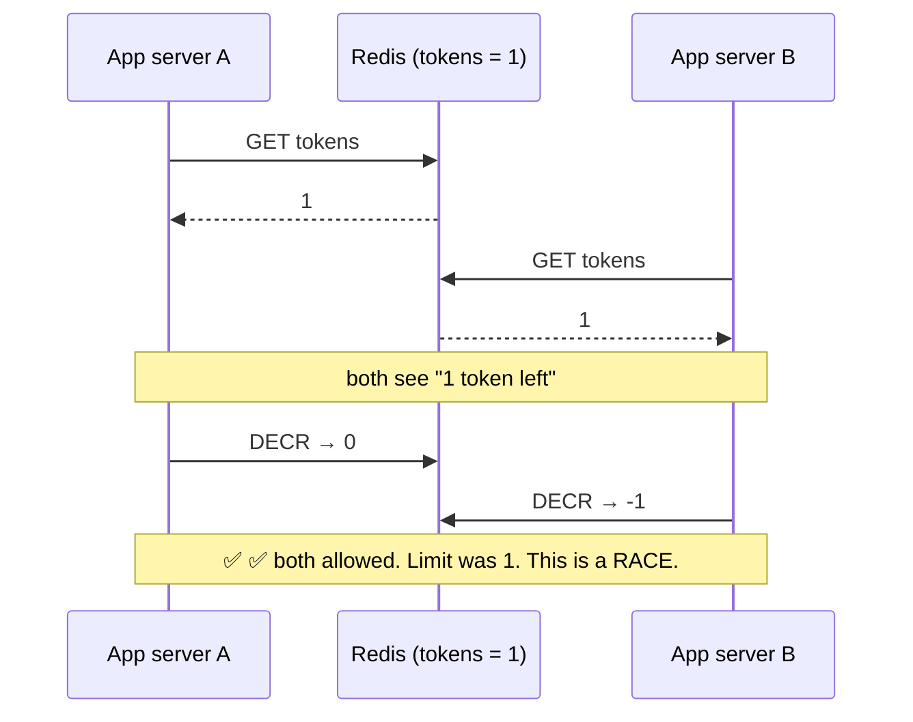
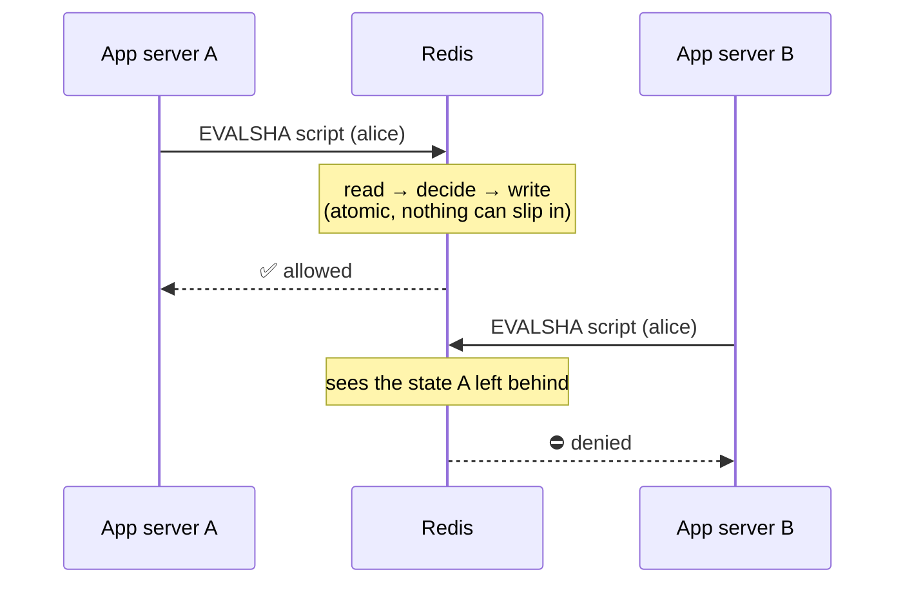
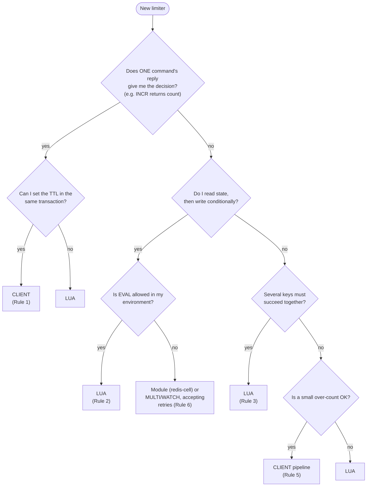
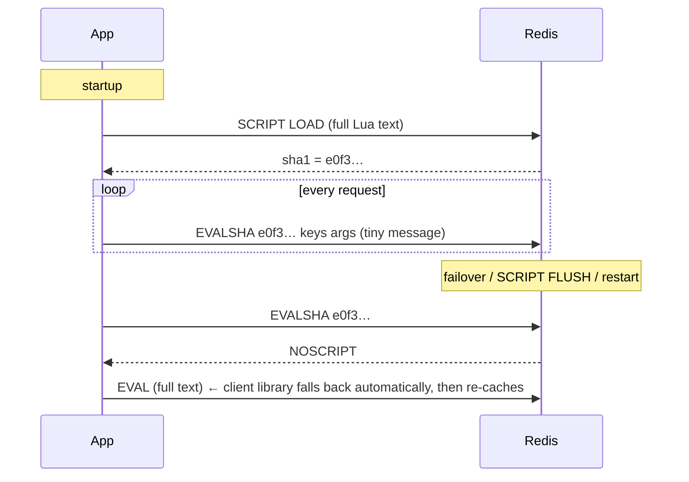

# 03 · Lua vs Client, Lua's Costs, and the Production Checklist

> Assumes **Redis 7+**. You do not need to know Lua. Section 2 teaches you to *read* the scripts in this repo in five minutes.
> Time to read: ~40 minutes.

---

## Table of contents

1. [The core problem: races](#1-the-core-problem-races)
2. [A 5-minute Lua primer for reading the scripts](#2-a-5-minute-lua-primer)
3. [The decision rules: Lua or client?](#3-the-decision-rules-lua-or-client)
4. [Applying the rules: every algorithm in this repo](#4-applying-the-rules)
5. [What Lua costs you (and what it gives you)](#5-lua-pros-and-cons)
6. [How scripts are loaded and versioned](#6-loading-and-versioning-scripts)
7. [Redis Cluster and hash tags](#7-redis-cluster-and-hash-tags)
8. [The production checklist, with the *why* for each item](#8-the-production-checklist)
9. [Testing a rate limiter](#9-testing-a-rate-limiter)
10. [Where to read next](#10-where-to-read-next)

---

## 1. The core problem: races

Redis runs commands **one at a time**. But *your app* talks to Redis in **several round trips**, and between two round trips **other app instances can slip in**.

### The naive limiter (client-side read, then write)

```python
# DON'T DO THIS: read, think, write in three separate steps
tokens = redis.get("rl:alice")          # 1) read
if int(tokens or 0) > 0:                # 2) decide in Python
    redis.decr("rl:alice")              # 3) write
    allow()
```

Two app servers handle two requests from Alice at the same instant. Alice has **1** token left:



Scale this to 200 concurrent requests and a limit of 10, and you can let **dozens** through.

### The fix: make "read + decide + write" one indivisible step

A Lua script runs **inside Redis** and Redis runs it **start to finish with nothing else interleaved**:



Same logic, but the second caller *sees the result of the first*. **That is the entire reason Lua exists in rate limiters.**

> Every Lua project in this repo ships `scripts/race_demo.py`. It runs the naive version and the Lua version with 200 parallel requests and prints how many each one let through.

---

## 2. A 5-minute Lua primer

Here is a complete, real, tiny script (a counter with a limit) with every line explained:

```lua
-- KEYS[1] = the Redis key to use          (passed by the app)
-- ARGV[1] = the limit                     (passed by the app)
-- ARGV[2] = window in milliseconds        (passed by the app)

local count = redis.call('INCR', KEYS[1])          -- run a Redis command; store the reply
if count == 1 then                                  -- first request in this window?
  redis.call('PEXPIRE', KEYS[1], ARGV[2])           -- set the key's expiry
end
if count > tonumber(ARGV[1]) then                   -- ARGV values are strings → convert
  return 0                                          -- ⛔ denied
end
return 1                                            -- ✅ allowed
```

| Piece | Meaning |
|---|---|
| `KEYS[n]` | The Redis keys this script touches (declared up-front; required for Cluster) |
| `ARGV[n]` | Everything else the app passes in (limits, costs, ids). **Always strings**, so wrap with `tonumber()` |
| `redis.call('CMD', ...)` | Run a Redis command. Aborts the script on error |
| `redis.call('TIME')` | Redis's own clock → `{seconds, microseconds}` (we use it so all app servers share **one** clock) |
| `local x = ...` | A variable |
| `return ...` | The reply sent back to your app (numbers, strings, arrays) |

That's 90% of what the scripts in this repo use. Everything else is arithmetic.

---

## 3. The decision rules: Lua or client?

These rules are numbered so project READMEs can cite them ("this project uses Lua because of Rule 2").

### Rule 1: One command decides → use the **client**

If a **single Redis command's return value** is enough to make the decision, you don't need Lua.

> **Example: fixed window.** `INCR rl:{alice}:fw:171` returns the new count. `count <= limit` → allow. There is nothing to read first.

```python
# MULTI makes INCR + EXPIRE one atomic unit; EXPIRE ... NX (Redis 7+) sets the TTL only if none exists
pipe = r.pipeline(transaction=True)
pipe.incr(key)
pipe.expire(key, window_s, nx=True)
count, _ = await pipe.execute()
allowed = count <= limit
```

### Rule 2: The decision needs a value you must **read first**, then write conditionally → **Lua**

If you must `GET` something, compute, and then `SET` depending on the result, the gap between read and write is a race (section 1). `WATCH`/`MULTI` retry loops can emulate this, but under contention they retry repeatedly, which is exactly when you need the limiter most.

> **Example: GCRA.** Read TAT → compute new TAT → conditionally write. Lua.
> **Example: sliding window log.** Remove old entries → count → *only if under limit* add. Lua.

### Rule 3: Several keys must succeed or fail **together** → **Lua**

> **Example: multi-rule.** `per-second` AND `per-hour` AND `per-day`. If the day rule denies, the other two must **not** be charged (doc 01 §5.2). A client can't do that atomically across multiple round trips.

### Rule 4: The decision depends on **time** → prefer Lua (`redis.call('TIME')`)

If app servers compute `now` themselves, their clocks disagree.

```text
Server A clock: 12:00:00.000        Server B clock: 12:00:00.800
Alice hits A then B within 100 ms.
Token bucket sees time go 12:00:00.000 → 12:00:00.800 (!) and refills 0.8 s of tokens that never elapsed.
```

If you must use the client, accept the skew or sync clocks tightly (NTP/chrony).

### Rule 5: A cheap **over-count is acceptable** and commands are independent → **client pipeline**

If occasionally letting through (or blocking) a request is harmless, a pipeline is fine and simpler.

> **Example:** per-day email quota of 1,000 where 1,001 vs 1,000 doesn't matter.

### Rule 6: The environment **forbids or complicates `EVAL`** → client

Some managed Redis offerings, proxies, or ACL setups restrict scripting. In that case use transactions/pipelines and accept the Rule 5 compromises, **or** use a Redis module such as `redis-cell` (GCRA as a native command), if your platform allows modules.

### Rule 7: Keep scripts **O(1) or O(log n)**

Redis executes scripts on its single thread. If a script loops over 100,000 entries, **every other client waits**.

```text
O(1)   : GCRA, token bucket, fixed window        → ~microseconds
O(log n): ZADD / ZREMRANGEBYSCORE on small ZSETs → fine
O(n)   : "scan all keys", "loop over every lease" → ⛔ never inside a script
```

### The one-line version

> **If the decision depends on a value you must read first → Lua. If a single command's return value decides → client.**

### The decision tree



---

## 4. Applying the rules

| Project | Engine | Rule(s) | Reasoning in one sentence |
|---|---|---|---|
| `01_fixed_window` | **Client** | 1 | `INCR` returns the count; `EXPIRE NX` in the same `MULTI` handles TTL |
| `02_sliding_window_log` | **Lua** | 2, 4 | Must count *before* adding (so denied requests aren't logged) and use one clock |
| `03_sliding_window_counter` | **Lua** | 2, 4 | Reads two counters, computes a weighted estimate, then conditionally increments |
| `04_token_bucket` | **Lua** | 2, 4 | Lazy refill needs time + read-modify-write of a hash |
| `05_gcra` | **Lua** | 2, 4 | Read TAT → compute → conditional write |
| `06_concurrency` acquire | **Lua** | 2 | Remove expired + count + conditional add |
| `06_concurrency` release | **Client** | 1 | A single `ZREM` |
| `policies/01_multi_rule` | **Lua** | 3 | All-or-nothing over several keys |
| `policies/03_weighted_cost` | **Lua** | 2 | Same as GCRA with `cost`; refund is another small script |
| `policies/04_failure_modes`, `05_shadow_mode` | App-level | n/a | Policy around the call, not inside it |

### Same limiter, two engines: what changes

**Sliding window log, client-pipeline version** (works, but with a catch):

```python
pipe = r.pipeline(transaction=True)
pipe.zremrangebyscore(key, 0, now - window)   # drop old
pipe.zadd(key, {req_id: now})                  # add THIS request first
pipe.zcard(key)                                # then count
pipe.expire(key, window)
_, _, count, _ = await pipe.execute()
if count > limit:
    await r.zrem(key, req_id)                  # clean-up round trip for denied requests
```

Problems: (a) the **client clock** (`now`) is used (Rule 4); (b) a denied request is *briefly* inside the log, so a concurrent request can count it and be wrongly denied; (c) an extra round trip on every denial, i.e. exactly when load is highest.

**Lua version:** count first, add only if allowed, one clock, one round trip, no clean-up. Better on all three.

---

## 5. Lua: pros and cons

### Pros (each with the scenario that proves it)

| Pro | Scenario |
|---|---|
| **Atomicity** | 200 parallel requests, limit 10 → exactly 10 allowed (see `race_demo.py`) |
| **One round trip** | Multi-rule check with 3 rules: 1 network hop instead of 6. At 0.5 ms RTT that's 0.5 ms vs ~3 ms per request |
| **One clock** | App fleet of 40 servers with clock skew; limits stay correct because `TIME` is Redis's |
| **All-or-nothing** | Day rule denies → per-second and per-hour counters untouched |
| **Logic lives next to data** | No chatty read-modify-write traffic across the network |

### Cons (each with the scenario that hurts)

| Con | Scenario | Mitigation |
|---|---|---|
| **Harder to debug** | A script returns `{0, 2, 4200}`; why? Print-debugging isn't available | Keep scripts short, annotate every line, unit-test with a real Redis (testcontainers), return structured values |
| **Blocks Redis while running** | A script that loops 50,000 times freezes all clients for milliseconds | Keep O(1)/O(log n) (Rule 7); watch `SLOWLOG` |
| **Cluster key rules** | Script touches `rl:{ip:1.2.3.4}:x` and `rl:{user:42}:x` → `CROSSSLOT` error | All keys in one script share a hash tag (§7) |
| **Another artifact to ship** | A script change must roll out together with the app that expects its return shape | Version scripts; load by SHA; or use Redis Functions (§6) |
| **Script cache can be flushed** | Failover to a replica that never saw the script → `NOSCRIPT` error | Client libraries (`register_script`) transparently fall back to `EVAL` |
| **Less portable** | Some managed services restrict scripting | Rule 6 fallback, or choose a service that supports it |
| **Team familiarity** | New teammates can't read Lua | The primer (§2) + annotated scripts + this repo's READMEs |

### Cost of choosing wrong

| Wrong choice | Symptom |
|---|---|
| Client for a read-modify-write algorithm | Limit leaks under concurrency; passes tests, fails in production |
| Lua for a single `INCR` | Extra code to maintain with no benefit |
| Big loops in Lua | Redis latency spikes for *every* client, not just the limiter |

---

## 6. Loading and versioning scripts



* **`EVALSHA`** sends a 40-character hash instead of the script text: smaller packets, faster.
* In **redis-py**, `r.register_script(lua_text)` returns a callable that does this dance for you.
* **Redis Functions** (Redis 7+): scripts become named functions in a **library** that is **stored with the dataset** (persisted and replicated), so they survive restarts and failovers without the app re-loading them. Consider them once you have many scripts or strict deploy control. Check your managed provider supports them.

**Versioning tip:** include a version in the script file name (`gcra_v2.lua`) and keep the **return shape** stable. Deploy the app that understands the new shape *before* switching traffic to it.

---

## 7. Redis Cluster and hash tags

In Cluster, keys are spread across **16,384 slots**. A script (or `MULTI`) may only touch keys in **one slot**. The slot is computed from the text inside `{}` if present.

```text
rl:{user:42}:api:sec   ──┐
rl:{user:42}:api:hour  ──┴─► hash of "user:42" → same slot ✅  one script can use both

rl:{ip:1.2.3.4}:login  ──► slot A
rl:{user:42}:login     ──► slot B   ❌ CROSSSLOT: one script cannot touch both
```

**Do:** put the **identity** in the braces.
**Don't:** put a constant in the braces.

```text
✅ rl:{user:42}:api:sec         → 1,000,000 users spread over all slots
❌ rl:{api}:user:42:sec          → EVERY key shares one slot → one shard takes 100% of limiter traffic
```

If you genuinely need two identities in one atomic script (e.g. IP + account for login), see the three options in doc 01 §3.3.

---

## 8. The production checklist

Each item: **what**, **why (with a scenario)**, **what to do**.

### 8.1 Decide the failure mode per route

* **Why:** Redis failover takes 20 s at peak. Fail-open on `/login` = brute force window. Fail-closed on `/products` = site outage.
* **Do:** Per-route policy: fail-closed for login/OTP/payments/expensive jobs; fail-open or local fallback elsewhere. Emit `fail_open` metric on every bypass and alert on it.

### 8.2 Set a short Redis timeout

* **Why:** Redis is slow (not down) and each call blocks 2 s. Every request now takes 2 s longer. The limiter caused the outage.
* **Do:** Socket + command timeouts in the tens of milliseconds. A timed-out call is treated as a failure → apply the failure mode.

### 8.3 Protect hot keys

* **Why:** One abusive user (or a `global` key) sends 50k req/s at **one** key on **one** shard.
* **Do:** Edge limiter first (CDN / nginx / Envoy / API gateway) to drop obvious floods before they reach Redis. Never use a constant in the hash tag. For true global limits, consider sharding the global budget (N keys, each `limit/N`).

### 8.4 Keep every key bounded in time

* **Why:** A million one-time visitors → a million keys. If any lack a TTL, memory grows forever.
* **Do:** TTL on every key, set in the same atomic step as the write. GCRA: TTL = time until TAT passes. Add `maxmemory` + an eviction policy as a safety net, and alert on key count for `rl:*`.

### 8.5 Make the identity trustworthy

* **Why:** Attacker sets `X-Forwarded-For` to a random value every request → fresh bucket every time → no limit at all.
* **Do:** Trust only proxy-appended entries (doc 01 §3.6). Prefer authenticated identity when available. Limit by `/64` for IPv6.

### 8.6 Return honest, standard headers

* **Why:** Clients that don't know when to retry retry *immediately*, forever.
* **Do:** Always `Retry-After` on `429`. Consider `RateLimit-*` headers (the IETF draft is still evolving; check current naming). Return a JSON body with the violated rule name.

### 8.7 Handle weighted and after-the-fact cost

* **Why:** An LLM call's token usage is only known after it finishes. Charging 1 per request lets a user with huge prompts blow through your budget.
* **Do:** Reserve an estimate before, settle the difference after (refund script). Reject `cost > burst` permanently (`4xx`, not a retryable `429`).

### 8.8 Idempotent retries

* **Why:** Client times out and retries; the first attempt actually succeeded and consumed quota. The user is double-charged.
* **Do:** For expensive or billed operations, key a short-lived dedupe record on a request/idempotency id.

### 8.9 Observability

* **Why:** "Users say they're being blocked." Without metrics you can't tell whether it's an attack, a bad limit, or a bug.
* **Do:** `rl_decisions_total{limiter,rule,outcome}`, latency histogram, `fail_open` counter, and a dashboard. Log the **violated rule** and identity (hashed if sensitive) on denial.

### 8.10 Roll out with shadow mode

* **Why:** A new limit blocks your biggest customer on day one.
* **Do:** Shadow → review `shadow_denied` → adjust → enforce. Keep an allowlist for health checks and trusted internal callers.

### 8.11 Configuration as data

* **Why:** A customer upgrade needs a higher limit *now*.
* **Do:** Rules/plans in config or DB, cached in-process with a short TTL, per-tenant overrides, validated on load (reject `burst < cost`, `limit ≤ 0`).

### 8.12 Multi-region

* **Why:** One Redis in `us-east` adds 80 ms to every request served from `eu-west`.
* **Do:** Per-region limiters with `limit / regions` each (simple, approximate), or accept a slightly stale global view via async sync. Don't call a cross-region Redis on the hot path.

### 8.13 Keep scripts cheap and watch them

* **Why:** One accidentally O(n) script spikes p99 for the whole Redis.
* **Do:** O(1)/O(log n) only (Rule 7). Monitor `SLOWLOG` and `LATENCY`. Review every script change like a database migration.

### 8.14 Don't forget the unhappy paths

| Situation | Expected behaviour |
|---|---|
| `NOSCRIPT` after failover | Library falls back to `EVAL`; no user-visible error |
| Redis restarts (no persistence) | All limits reset to full; acceptable for most, noted for fail-closed endpoints |
| Clock jump on Redis host | Time moves backward → GCRA/TAT logic must tolerate `tat > now` (it does: `max(tat, now)`) |
| Request with `cost > burst` | Permanent rejection, not retryable |
| Identity missing | Decide explicitly: reject, or fall back to IP. Never silently use an empty key (that creates a shared global bucket for all unidentified callers) |

---

## 9. Testing a rate limiter

| Test | What it proves | Example |
|---|---|---|
| **Unit (fake repository)** | Service logic: key building, mode handling, failure modes | Shadow mode converts `denied` → `shadow_denied` |
| **Script invariants (real Redis)** | Algorithm correctness | After N allowed requests the (N+1)th is denied; `Retry-After` ≈ expected; denied requests didn't change state |
| **TTL test** | No immortal keys | After the burst, `PTTL key > 0` for every `rl:*` key |
| **Concurrency test** | Atomicity | 200 parallel requests, limit 10 → **exactly** 10 allowed |
| **Property test** | "Never more than `limit + burst` in any window" | Randomised request timelines checked against an oracle |
| **Time-travel test** | Refill/recovery | Advance mocked time (or sleep short windows) and assert recovery |
| **Chaos test** | Failure modes | Stop Redis mid-traffic; fail-open routes keep serving, fail-closed routes return 503 |
| **Contract test** | Same HTTP behaviour across all projects | 429 + `Retry-After` + JSON body |

**Use a real Redis** (testcontainers or the compose `redis` service). A mock cannot catch races or Lua mistakes.

---

## 10. Where to read next

* The algorithms these scripts implement → [`02-algorithms.md`](02-algorithms.md)
* The axes and layered architecture → [`01-axes-and-architecture.md`](01-axes-and-architecture.md)
* Resources (`05-resources.md`, to be written in Phase 5). Starting points:

| Resource | Read it when |
|---|---|
| Stripe's engineering post on rate limiters | First, for the real-world motivation and the four limiter types they use |
| Brandur's post on rate limiting and GCRA | Before writing `05_gcra`, for the clearest explanation of the algorithm |
| Cloudflare's post on counting at scale | Before `03_sliding_window_counter` and when thinking about distributed counting |
| Figma's post on an alternative approach to rate limiting | Before the failure-mode and fairness policies |
| Redis docs: scripting, Functions, Cluster spec (hash tags) | Before §6 and §7 of this doc |
| `brandur/redis-cell` | To see GCRA as a native Redis command (Rule 6 alternative) |
| `go-redis/redis_rate` | A short, readable GCRA-in-Lua reference to compare against `05_gcra` |
| `envoyproxy/ratelimit` | When designing config/descriptor-style policies (`policies/02`) |
| `alisaifee/limits` and `slowapi` | To compare against a ready-made Python library before deciding to build your own |

> These are given from memory without browsing. **Open and verify every link, and note the verification date, before you publish `05-resources.md`.**
