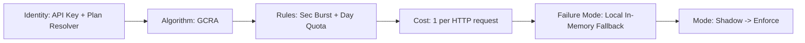
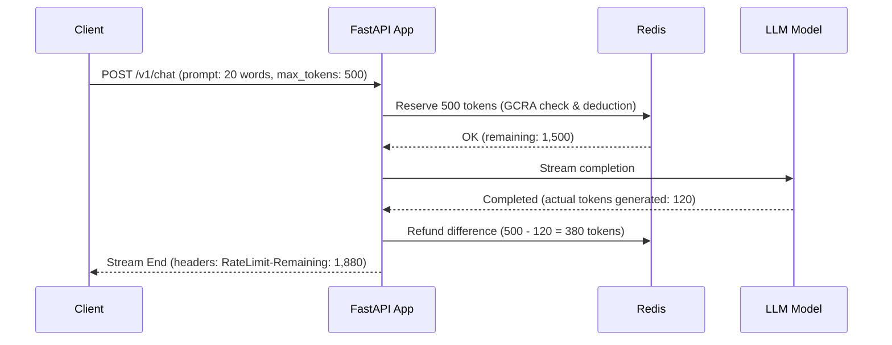

# 04 · Use-Case Recipes ("I'm Building X")

A practical catalog of ten production scenarios. Each recipe specifies the six rate limiter axes, diagrams the request flow, lists which reference folders in this repository to copy, and provides ready-to-use configuration and integration snippets.

---

## The Recipe Index

| # | Use Case | Primary Need | Key Patterns | Reference Projects |
|---|---|---|---|---|
| 1 | **Public SaaS REST API** | Paid customer tiers, smooth bursts | GCRA + Multi-rule + Tiered Identity | [`05_gcra`](../rate_limiters/algorithms/05_gcra), [`01_multi_rule`](../rate_limiters/policies/01_multi_rule), [`02_identity`](../rate_limiters/policies/02_identity_strategies) |
| 2 | **Authentication & Login** | Brute force & credential stuffing defense | Dual-key (Account + IP) + Sliding Log | [`02_sliding_log`](../rate_limiters/algorithms/02_sliding_window_log), [`04_failure_modes`](../rate_limiters/policies/04_failure_modes) |
| 3 | **LLM Chat & Inference** | Dynamic token generation costs | Variable Cost + Estimate & Refund + Concurrency | [`03_weighted_cost`](../rate_limiters/policies/03_weighted_cost), [`06_concurrency`](../rate_limiters/algorithms/06_concurrency) |
| 4 | **Heavy Report / CSV Export** | Resource starvation prevention | Concurrency Lease + Auto-Expiry | [`06_concurrency`](../rate_limiters/algorithms/06_concurrency), [`05_gcra`](../rate_limiters/algorithms/05_gcra) |
| 5 | **Outbound Webhook Dispatcher** | Third-party endpoint protection | Token Bucket Burst Smoothing | [`04_token_bucket`](../rate_limiters/algorithms/04_token_bucket), [`05_gcra`](../rate_limiters/algorithms/05_gcra) |
| 6 | **Internal Service Mesh** | Microservice blast-radius isolation | High-throughput GCRA + Fail-Open | [`05_gcra`](../rate_limiters/algorithms/05_gcra), [`04_failure_modes`](../rate_limiters/policies/04_failure_modes) |
| 7 | **Analytical Query API** | Complex SQL / query cost governance | Cost > Burst fatal drop + Weighted GCRA | [`03_weighted_cost`](../rate_limiters/policies/03_weighted_cost) |
| 8 | **Public Scraping Defense** | Edge crawler suppression | Sliding Window Counter + Trusted Proxy IP | [`03_sliding_counter`](../rate_limiters/algorithms/03_sliding_window_counter), [`02_identity`](../rate_limiters/policies/02_identity_strategies) |
| 9 | **Payment & Checkout** | Double-submit & fraud mitigation | Idempotency / Single-flight Concurrency | [`06_concurrency`](../rate_limiters/algorithms/06_concurrency), [`04_failure_modes`](../rate_limiters/policies/04_failure_modes) |
| 10 | **Legacy Limit Rollout** | Zero-downtime limit introduction | Shadow Mode + Allowlist Bypass | [`05_shadow_mode`](../rate_limiters/policies/05_shadow_mode), [`04_failure_modes`](../rate_limiters/policies/04_failure_modes) |

---

## Recipe 1: Public SaaS REST API with Customer Tiers

### Scenario
You run a developer platform with Free, Pro, and Enterprise tiers. Callers identify via API keys (`Bearer sk_live_...`). You need short-burst smoothing (requests/second) plus a hard monthly or daily quota (requests/day).

### Axis Decisions


### Reference Projects to Copy
- Algorithm: [`rate_limiters/algorithms/05_gcra`](../rate_limiters/algorithms/05_gcra)
- Multi-tier rules: [`rate_limiters/policies/01_multi_rule`](../rate_limiters/policies/01_multi_rule)
- Identity resolution: [`rate_limiters/policies/02_identity_strategies`](../rate_limiters/policies/02_identity_strategies)
- Failure resilience: [`rate_limiters/policies/04_failure_modes`](../rate_limiters/policies/04_failure_modes)

### Integration Snippet
```python
# Tier definitions: (limit, period_seconds, burst)
TIER_RULES = {
    "free": [
        ("per_sec", 5, 1, 5),          # 5 req/s burst
        ("per_day", 1000, 86400, 1000) # 1,000 req/day
    ],
    "pro": [
        ("per_sec", 50, 1, 50),
        ("per_day", 100000, 86400, 100000)
    ]
}

async def rate_limit_dependency(request: Request, response: Response):
    api_key = request.headers.get("Authorization", "").removeprefix("Bearer ")
    tenant, plan = await lookup_api_key(api_key)
    rules = TIER_RULES.get(plan, TIER_RULES["free"])
    
    # Atomic all-or-nothing multi-rule GCRA evaluation
    decision = await multi_rule_service.evaluate(identity=f"tenant:{tenant}", rules=rules)
    if not decision.allowed:
        raise HTTPException(status_code=429, detail={"error": "rate_limited", "rule": decision.violated_rule})
```

---

## Recipe 2: Authentication & Login Endpoint (Anti-Brute-Force)

### Scenario
A `POST /api/v1/auth/login` endpoint is targeted by credential stuffing attacks. You must enforce two separate barriers:
1. Max 5 failed attempts per target **Account** per 5 minutes.
2. Max 50 attempts per client **IP** per 5 minutes (blocking distributed sweeps).

### Axis Decisions
- **Identity:** Dual Keys: `account:{email}` AND `ip:{trusted_client_ip}`.
- **Algorithm:** Sliding Window Log ([`02_sliding_window_log`](../rate_limiters/algorithms/02_sliding_window_log)) or GCRA.
- **Cost:** 1 per login attempt.
- **Failure Mode:** **Fail-Closed** ([`04_failure_modes`](../rate_limiters/policies/04_failure_modes)) — if Redis is down, reject authentication to avoid offline credential cracking.
- **Mode:** Enforce.

### Reference Projects to Copy
- [`rate_limiters/algorithms/02_sliding_window_log`](../rate_limiters/algorithms/02_sliding_window_log)
- [`rate_limiters/policies/04_failure_modes`](../rate_limiters/policies/04_failure_modes)

### Key Pattern
```python
@router.post("/login")
async def login(credentials: LoginSchema, request: Request):
    ip = resolve_client_ip(request, trusted_proxies=["10.0.0.0/8"])
    account = credentials.email.lower()
    
    # 1. Check IP barrier (Fail-closed on Redis outage)
    ip_decision = await limiter.evaluate(identity=f"ip:{ip}", limit=50, window=300, fail_mode="closed")
    if not ip_decision.allowed:
        raise HTTPException(status_code=429, detail="Too many login attempts from this network.")
        
    # 2. Check Account barrier
    acc_decision = await limiter.evaluate(identity=f"acc:{account}", limit=5, window=300, fail_mode="closed")
    if not acc_decision.allowed:
        raise HTTPException(status_code=429, detail=f"Account locked. Retry in {acc_decision.retry_after}s.")
```

---

## Recipe 3: LLM Chat & Inference (Estimate-Then-Refund)

### Scenario
An AI completion endpoint streams tokens. Prompts vary widely in output length:
- Short prompt: 50 tokens.
- Large code generation: 1,500 tokens.
Charging 1 per request allows users to exhaust your GPU cluster, while charging a static 2,000 blocks legitimate fast queries.

### Axis Decisions
- **Identity:** User ID (`user:{sub}`).
- **Algorithm:** Weighted GCRA ([`03_weighted_cost`](../rate_limiters/policies/03_weighted_cost)) + Concurrency Lease ([`06_concurrency`](../rate_limiters/algorithms/06_concurrency)).
- **Cost:** Reserve estimated tokens upfront; refund unused tokens upon stream termination.
- **Failure Mode:** Fail-Closed (protects direct cloud billing).
- **Mode:** Enforce.

### Execution Flow


### Reference Projects to Copy
- [`rate_limiters/policies/03_weighted_cost`](../rate_limiters/policies/03_weighted_cost)
- [`rate_limiters/algorithms/06_concurrency`](../rate_limiters/algorithms/06_concurrency)

---

## Recipe 4: Heavy Report & Bulk CSV Export

### Scenario
Users trigger `POST /reports/export-annual-data`. Generating the file takes 45 seconds, loads 2 GB of memory, and locks database worker connections. Multiple rapid clicks will crash the worker node.

### Axis Decisions
- **Identity:** User ID (`user:{id}`).
- **Algorithm:** **Concurrency Limiter** ([`06_concurrency`](../rate_limiters/algorithms/06_concurrency)) with TTL-backed heartbeats.
- **Rules:** Max 1 in-flight export job per user; max 5 across the entire company tenant.
- **Failure Mode:** Fail-Closed.
- **Mode:** Enforce.

### Reference Projects to Copy
- [`rate_limiters/algorithms/06_concurrency`](../rate_limiters/algorithms/06_concurrency)

### Implementation Pattern
```python
@router.post("/reports/export")
async def export_report(request: Request, user: User = Depends(get_current_user)):
    # 1. Acquire lease (limit=1 in-flight job, lease_ttl=120s)
    lease = await concurrency_limiter.acquire(
        resource=f"report_export:{user.id}",
        capacity=1,
        ttl_seconds=120
    )
    if not lease.acquired:
        raise HTTPException(
            status_code=429,
            detail="A report is already generating for your account. Please wait for completion."
        )
        
    try:
        # Run long export
        file_url = await generate_csv_archive(user)
        return {"download_url": file_url}
    finally:
        # 2. Release slot immediately upon exit
        await concurrency_limiter.release(lease)
```

---

## Recipe 5: Outbound Webhook Dispatcher (Partner Rate Protection)

### Scenario
Your background worker pool dispatches webhooks to external partners (e.g., Salesforce, Slack, customer endpoints). Sending thousands of concurrent webhooks trips their rate limits and causes delivery failures.

### Axis Decisions
- **Identity:** Target Host / Partner Domain (`host:api.partner.com`).
- **Algorithm:** Token Bucket ([`04_token_bucket`](../rate_limiters/algorithms/04_token_bucket)) or GCRA ([`05_gcra`](../rate_limiters/algorithms/05_gcra)).
- **Rules:** 20 req/sec steady, burst allowance of 50.
- **Failure Mode:** Backpressure Queue (pause worker consumption if Redis or partner fails).

### Reference Projects to Copy
- [`rate_limiters/algorithms/04_token_bucket`](../rate_limiters/algorithms/04_token_bucket)
- [`rate_limiters/algorithms/05_gcra`](../rate_limiters/algorithms/05_gcra)

---

## Recipe 6: Internal Microservices Mesh (Blast Radius Isolation)

### Scenario
Service A calls Service B inside a Kubernetes cluster. A bug in Service A creates a tight retry loop that floods Service B, threatening other internal consumers.

### Axis Decisions
- **Identity:** Caller Service Account (`service:billing-service`).
- **Algorithm:** GCRA ([`05_gcra`](../rate_limiters/algorithms/05_gcra)).
- **Rules:** High throughput (5,000 req/s, burst 10,000).
- **Failure Mode:** **Fail-Open** ([`04_failure_modes`](../rate_limiters/policies/04_failure_modes)) — internal infrastructure must not halt core business operations if the rate-limiter Redis cluster undergoes a failover.
- **Mode:** Shadow rollout for 2 weeks, then enforce.

### Reference Projects to Copy
- [`rate_limiters/algorithms/05_gcra`](../rate_limiters/algorithms/05_gcra)
- [`rate_limiters/policies/04_failure_modes`](../rate_limiters/policies/04_failure_modes)
- [`rate_limiters/policies/05_shadow_mode`](../rate_limiters/policies/05_shadow_mode)

---

## Recipe 7: Analytical Database Query API

### Scenario
A GraphQL or SQL query proxy executes dynamic queries against Snowflake/ClickHouse. Simple lookups cost 1 unit; multi-month aggregation scans cost 50 units. Queries costing > 100 units exceed the cluster's burst memory and must be rejected immediately.

### Axis Decisions
- **Identity:** Client Workspace ID.
- **Algorithm:** Weighted GCRA ([`03_weighted_cost`](../rate_limiters/policies/03_weighted_cost)).
- **Rules:** Capacity = 100 units, refill = 10 units/sec.
- **Special Rule:** Fatal Permanent Rejection (`cost > burst` → HTTP 422 Unprocessable Entity).

### Reference Projects to Copy
- [`rate_limiters/policies/03_weighted_cost`](../rate_limiters/policies/03_weighted_cost)

---

## Recipe 8: Public Scraping Defense (Edge Reverse Proxy)

### Scenario
A public catalog or documentation site is aggressively indexed by rogue crawlers. You want lightweight per-IP rate limiting that uses minimal Redis memory.

### Axis Decisions
- **Identity:** Client IP extracted via trusted proxy validation (`X-Forwarded-For`).
- **Algorithm:** **Sliding Window Counter** ([`03_sliding_window_counter`](../rate_limiters/algorithms/03_sliding_window_counter)).
  - *Why:* Only 2 integer keys per client IP; bounds memory consumption to O(1) regardless of request volume.
- **Rules:** 100 requests per minute.
- **Failure Mode:** Fail-Open.

### Reference Projects to Copy
- [`rate_limiters/algorithms/03_sliding_window_counter`](../rate_limiters/algorithms/03_sliding_window_counter)
- [`rate_limiters/policies/02_identity_strategies`](../rate_limiters/policies/02_identity_strategies)

---

## Recipe 9: Payment Gateway & Checkout (Double-Click Defense)

### Scenario
On an e-commerce checkout page, an impatient user double-clicks "Pay Now", or an automated bot submits concurrent card verification attempts.

### Axis Decisions
- **Identity:** Fingerprint = `checkout:{user_id}:{idempotency_key}`.
- **Algorithm:** Concurrency Lease with TTL ([`06_concurrency`](../rate_limiters/algorithms/06_concurrency)) + Short Fixed Window.
- **Rules:** Exactly 1 in-flight execution at any time.
- **Failure Mode:** Fail-Closed.

### Reference Projects to Copy
- [`rate_limiters/algorithms/06_concurrency`](../rate_limiters/algorithms/06_concurrency)
- [`rate_limiters/policies/04_failure_modes`](../rate_limiters/policies/04_failure_modes)

---

## Recipe 10: Zero-Downtime Rate Limit Rollout for Legacy Monolith

### Scenario
You are adding rate limiting to a 5-year-old API with hundreds of enterprise customers. You do not know existing traffic distributions and cannot risk breaking valid customer workflows.

### Axis Decisions
- **Identity:** API Key.
- **Algorithm:** GCRA ([`05_gcra`](../rate_limiters/algorithms/05_gcra)).
- **Mode Lifecycle:**
  1. **Phase 1 (Shadow):** Deploy with `RL_MODE=shadow`. Observe `rl_shadow_denied_total` in Grafana.
  2. **Phase 2 (Tune & Allowlist):** Add VIPs and internal batch jobs to `RL_ALLOWLIST`. Adjust quotas for heavy consumers.
  3. **Phase 3 (Enforce):** Switch to enforcement dynamically via `POST /admin/mode?mode=enforce` with **zero code changes** and **zero restarts**.

### Reference Projects to Copy
- [`rate_limiters/policies/05_shadow_mode`](../rate_limiters/policies/05_shadow_mode)
- [`rate_limiters/policies/04_failure_modes`](../rate_limiters/policies/04_failure_modes)
