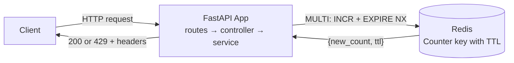
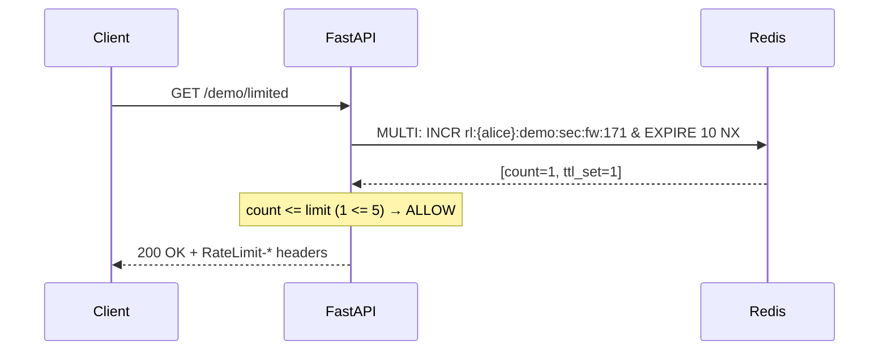

# Fixed Window  ·  The Simplest Counter

| | |
|---|---|
| **Engine** | Client (Rule 1: one `INCR` command decides) |
| **Redis structure** | String (integer counter) |
| **Memory per identity** | O(1) (~60 bytes per active window) |
| **Accuracy** | Approximate across window edges (vulnerable to 2× boundary spike) |
| **Burst behaviour** | Allows full limit instantly at window start; spike across boundary |
| **Run it** | `make up P=fixed-window` → http://localhost:8101 |

> **Use it when:** You need a simple per-hour or per-day quota where an occasional burst across the boundary is harmless.  
> **Avoid it when:** You need smooth traffic shaping, protection against brute-force attacks, or strict rate guarantees.

---

## 1. The idea in one picture

A nightclub doorman with a clicker that counts guests who enter. Every time the clock strikes the top of the hour, the doorman resets the clicker back to zero.

```text
Window 0: [00:00 - 01:00)           Window 1: [01:00 - 02:00)
┌───────────────────────┐           ┌───────────────────────┐
│ Counter: 5 / 5 [FULL] │  ─RESET─► │ Counter: 0 / 5 [EMPTY]│
└───────────────────────┘           └───────────────────────┘
```

The boundary flaw: 5 guests enter at 00:59, and 5 more enter at 01:00. Over 2 minutes, 10 guests entered!

---

## 2. Who does what



| Actor | Owns | Never does |
|---|---|---|
| **App** | Calculating window ID `floor(now / period)`, building key, turning count into HTTP headers | Relying on separate GET then SET |
| **Redis** | Atomic `INCR` and conditional `EXPIRE ... NX` | Knowing about HTTP or business rules |

---

## 3. What is stored in Redis

One integer string key per caller and per window:

```text
KEY   rl:{user:alice}:demo:sec:fw:1714000      TYPE string   TTL 10s
VALUE 4                                        ← 4 requests consumed in window #1714000
```

* The hash tag `{user:alice}` ensures cluster placement hashes on the identity.
* The key self-expires via TTL. Idle users leave zero leftover keys in Redis.

---

## 4. Step-by-step with a worked example

Config: `limit = 3, period = 10s` (Window 10: `t=100s..110s`, Window 11: `t=110s..120s`)

| Time | Request | Window ID | State before | Redis Op | State after | Decision | Why |
|---|---|---|---|---|---|---|---|
| 100.0s | #1 | 10 | empty | `INCR` + `EXPIRE 10 NX` | 1 (TTL 10s) | ✅ 200 | count 1 ≤ 3 |
| 102.5s | #2 | 10 | 1 | `INCR` | 2 (TTL 8s) | ✅ 200 | count 2 ≤ 3 |
| 105.0s | #3 | 10 | 2 | `INCR` | 3 (TTL 5s) | ✅ 200 | count 3 ≤ 3 |
| 107.0s | #4 | 10 | 3 | `INCR` | 4 (TTL 3s) | ⛔ 429 | count 4 > 3 |
| 110.1s | #5 | 11 | empty | `INCR` + `EXPIRE 10 NX` | 1 (TTL 10s) | ✅ 200 | New window! count 1 ≤ 3 |

---

## 5. The request flow



---

## 6. Code map

| Folder | File | Read it to learn |
|---|---|---|
| `app/services/` | `rate_limiter_service.py` | Window ID calculation and decision logic |
| `app/repositories/` | `redis_repository.py` | Atomic `INCR` + `EXPIRE NX` pipeline |
| `app/controllers/` | `rate_limit_controller.py` | FastAPI header mapping and 429 translation |
| `app/routes/` | `demo.py`, `debug.py` | Example endpoints you can call |

---

## 7. Why Client (Rule 1)

According to **Rule 1** from `docs/03-lua-vs-client-and-production.md`:
> *"If a single Redis command's return value is enough to make the decision, you don't need Lua."*

`INCR` returns the exact new counter value. Combining `INCR` and `EXPIRE ... NX` inside a client `MULTI` transaction achieves full atomicity with zero round-trip races and without running Lua.

---

## 8. Run it

```bash
# Start redis and the fixed window service
docker compose --profile fixed-window up --build -d

# Call the rate limited endpoint
curl -i http://localhost:8101/demo/limited
```

---

## 9. See it work

### Scenario 1: Calm traffic
```bash
docker compose run --rm dev python -m tools.traffic --project fixed-window --scenario steady | python -m tools.viz
```
Output:
```text
fixed_window · limit 5/s · burst 5 · identity user:alice
─────────────────────────────────────────────────────────────
 t(s)   request   result    remaining   retry_after   redis state
  0.00   #1       ✅ 200     4           -             -
  0.50   #2       ✅ 200     3           -             -
  1.00   #3       ✅ 200     4           -             -
```

### Scenario 2: Burst then abuse
```bash
docker compose run --rm dev python -m tools.traffic --project fixed-window --scenario burst | python -m tools.viz
```
Output:
```text
fixed_window · limit 5/s · burst 5 · identity user:alice
─────────────────────────────────────────────────────────────
 t(s)   request   result    remaining   retry_after   redis state
  0.00   #1       ✅ 200     4           -             -
  0.01   #2       ✅ 200     3           -             -
  0.02   #3       ✅ 200     2           -             -
  0.03   #4       ✅ 200     1           -             -
  0.04   #5       ✅ 200     0           -             -
  0.05   #6       ⛔ 429     0           1s            -
  0.55   #7       ✅ 200     4           -             -
─────────────────────────────────────────────────────────────
 allowed 6 · denied 1 · peak burst 5
```

### Scenario 3: The Boundary Spike Flaw
```bash
docker compose run --rm dev python -m tools.traffic --project fixed-window --scenario boundary
```
Notice how sending a burst right before `t=10.0s` and immediately after `t=10.0s` lets up to **2× limit** through in a fraction of a second.

---

## 10. Configuration

| Env var | Meaning | Default |
|---|---|---|
| `REDIS_URL` | Redis connection URL | `redis://redis:6379/0` |
| `RL_LIMIT` | Max allowed requests per window | `5` |
| `RL_PERIOD_SECONDS` | Window duration in seconds | `1` |
| `RL_DEBUG` | Enables `/debug/state` endpoint | `"1"` |

---

## 11. Edge cases and failure modes

* **Clock skew:** Multi-server deployments rely on synchronized server clocks so window IDs match. Use NTP/chrony.
* **Boundary spikes:** A user can send 100% of their quota at the end of window $W$ and 100% at the start of window $W+1$, resulting in 200% traffic. If this is intolerable, use `02_sliding_window_log` or `05_gcra`.
* **Redis failure:** If Redis is unreachable, the controller fails open or closed according to `RL_FAIL_MODE`.

---

## 12. Plug it into your app

1. Copy `app/services/`, `app/repositories/`, `app/schemas/`, and `app/controllers/`.
2. Install requirements: `pip install fastapi redis pydantic pydantic-settings prometheus-client`.
3. In your FastAPI router:
   ```python
   from app.controllers.rate_limit_controller import RateLimitController
   from app.repositories.redis_repository import RedisRepository
   from app.schemas.rule import Rule
   from app.services.rate_limiter_service import RateLimiterService

   repo = RedisRepository(redis_client)
   service = RateLimiterService(repo)
   controller = RateLimitController(service)

   @app.get("/items", dependencies=[Depends(controller.require_rate_limit(Rule("api", 10, 60)))])
   async def list_items():
       return []
   ```

---

## 13. Trade-offs

| Strength | Weakness |
|---|---|
| Fastest possible execution (single client `INCR` pipeline) | 2× boundary spike across window transitions |
| Negligible memory (1 integer per active caller) | Bursty; does not smooth traffic over time |
| Zero Lua scripts needed; works in all Redis proxies | Requires NTP clock sync across app hosts |
