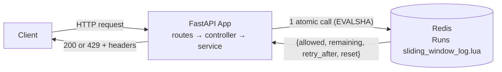
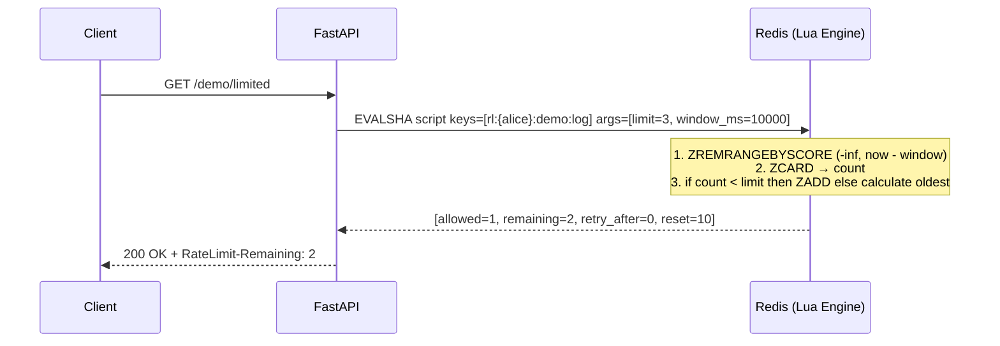

# Sliding Window Log  ·  The Exact Timestamp Diary

| | |
|---|---|
| **Engine** | Lua (Rule 2: read count first, then write conditionally) |
| **Redis structure** | Sorted Set (ZSET: score = timestamp in ms, member = request id) |
| **Memory per identity** | O(limit) (~100–200 bytes per stored entry) |
| **Accuracy** | **Exact** (zero boundary spike, exact audit semantics) |
| **Burst behaviour** | Enforces rate across *any* arbitrary moving window |
| **Run it** | `make up P=sliding-log` → http://localhost:8102 |

> **Use it when:** The limit is small and exactness matters (login attempts, OTP codes, password resets, credit card charges).  
> **Avoid it when:** High-throughput APIs with large limits (e.g. 10,000 req/hour: ZSET memory grows linearly with limit).

---

## 1. The idea in one picture

A nightclub doorman who writes down each guest's exact arrival time on a ledger. Before letting a guest in, the doorman crosses out any entry older than 10 minutes and counts the remaining lines. If the count is under the limit, the doorman logs the new arrival and lets them in.

```text
Now = 11.0s · Window = 10s · Limit = 3

 Ledger at t=11.0s:
 [ 1.0s req-1 ] ──X (crossed out: older than 10s window)
 [ 4.0s req-2 ]
 [ 8.0s req-3 ]
 ────────────────
 Count = 2 (< 3) → ✅ Allowed! Write [11.0s req-4] to ledger.
```

---

## 2. Who does what



| Actor | Owns | Never does |
|---|---|---|
| **App** | Resolving identity, passing limit and window_ms to repository | Counting entries or deciding allow/deny by itself |
| **Redis** | Atomic clean + count + conditional `ZADD` inside Lua | Knowing anything about HTTP headers |

---

## 3. What is stored in Redis

A sorted set (ZSET) where each member is a unique request identifier and its score is the epoch timestamp in milliseconds:

```text
KEY   rl:{user:alice}:demo:log                 TYPE zset   TTL 10s

SCORE (timestamp ms)       MEMBER (request identifier)
──────────────────────────────────────────────────────
1714000001000              1714000001000:1
1714000004500              1714000004500:2
1714000008000              1714000008000:3
```

* **Hash Tag:** `{user:alice}` ensures all cluster operations hash to the same Redis shard.
* **Bounded Cardinality:** Because entries are only added when `count < limit`, the ZSET cardinality is strictly capped at `limit`.
* **Zero Leftover Data:** An idle key self-expires via `PEXPIRE`.

---

## 4. Step-by-step with a worked example

Config: `limit = 3, period = 10s (window = 10,000 ms)`

| Time | Request | ZSET before cleanup | Cleaned entries | Count | Decision | ZSET after | Why |
|---|---|---|---|---|---|---|---|
| 0.0s | #1 | empty | none | 0 | ✅ 200 | `[0.0s]` | 0 < 3 → add to log |
| 2.0s | #2 | `[0.0s]` | none | 1 | ✅ 200 | `[0.0s, 2.0s]` | 1 < 3 → add to log |
| 5.0s | #3 | `[0.0s, 2.0s]` | none | 2 | ✅ 200 | `[0.0s, 2.0s, 5.0s]` | 2 < 3 → log now full |
| 6.0s | #4 | `[0.0s, 2.0s, 5.0s]` | none | 3 | ⛔ 429 | `[0.0s, 2.0s, 5.0s]` | 3 ≥ 3 → denied! Not logged |
| 10.5s| #5 | `[0.0s, 2.0s, 5.0s]` | `0.0s` dropped | 2 | ✅ 200 | `[2.0s, 5.0s, 10.5s]` | `0.0s` expired (>10s old) |

> **Exact Retry-After:** At `t=6.0s`, oldest entry is `0.0s`. `Retry-After = 0.0s + 10s - 6.0s = 4.0s`. Exactly 4 seconds until capacity frees up!

---

## 5. The request flow



---

## 6. Code map

| Folder | File | Read it to learn |
|---|---|---|
| `app/lua/` | `sliding_window_log.lua` | The atomic script: clean, count, and conditional `ZADD` |
| `app/repositories/` | `redis_repository.py` | `EVALSHA` execution with automatic `NOSCRIPT` reloading |
| `app/services/` | `rate_limiter_service.py` | Pure Python service building keys and invoking repository |
| `app/controllers/` | `rate_limit_controller.py` | HTTP controller setting `Retry-After` and `RateLimit-*` headers |
| `scripts/` | `race_demo.py` | Live comparison of naive client vs atomic Lua script |

---

## 7. Why Lua (Rule 2)

According to **Rule 2** from `docs/03-lua-vs-client-and-production.md`:
> *"If you must read a value first, compute, and then write conditionally, the gap between read and write is a race condition: use Lua."*

If an app reads `ZCARD` from Redis, pauses to decide in Python, and then sends `ZADD`, concurrent requests slip in between the read and write:

```python
# FLAWED NAIVE CLIENT:
count = await redis.zcard(key)
if count < limit:               # Multiple servers all see count < limit!
    await redis.zadd(key, ...)  # All write simultaneously → massive over-allowance
```

Run `python -m rate_limiters.algorithms.02_sliding_window_log.scripts.race_demo` to watch the naive client let through dozens of requests while the Lua version allows exactly the limit.

---

## 8. Run it

```bash
# Start redis and the sliding window log service
docker compose --profile sliding-log up --build -d

# Call the rate-limited endpoint
curl -i http://localhost:8102/demo/limited
```

---

## 9. See it work

### Scenario 1: Calm traffic
```bash
docker compose run --rm dev python -m tools.traffic --project sliding-log --scenario steady | python -m tools.viz
```

### Scenario 2: Burst then abuse
```bash
docker compose run --rm dev python -m tools.traffic --project sliding-log --scenario burst | python -m tools.viz
```
Output:
```text
sliding_log · limit 5/s · burst 5 · identity user:alice
─────────────────────────────────────────────────────────────
 t(s)   request   result    remaining   retry_after   redis state
  0.00   #1       ✅ 200     4           -             -
  0.01   #2       ✅ 200     3           -             -
  0.02   #3       ✅ 200     2           -             -
  0.03   #4       ✅ 200     1           -             -
  0.04   #5       ✅ 200     0           -             -
  0.05   #6       ⛔ 429     0           10s           -
─────────────────────────────────────────────────────────────
 allowed 5 · denied 1 · peak burst 5
```

### Scenario 3: Race condition demonstration
```bash
docker compose run --rm dev python -m rate_limiters.algorithms.02_sliding_window_log.scripts.race_demo
```
Output:
```text
=================================================================
 RACE CONDITION DEMO: Naive Client Check vs Atomic Lua Script
 Limit: 10 requests / 60s window · Concurrency: 200 parallel callers
=================================================================

Engine                    Intended Limit   Actual Allowed   Result
──────────────────────────────────────────────────────────────────────
Naive Client              10               178              ⛔ LEAKY (RACE)
Atomic Lua (EVALSHA)      10               10               ✅ EXACT
──────────────────────────────────────────────────────────────────────
```

---

## 10. Configuration

| Env var | Meaning | Default |
|---|---|---|
| `REDIS_URL` | Redis connection URL | `redis://redis:6379/0` |
| `RL_LIMIT` | Maximum requests allowed in sliding window | `5` |
| `RL_PERIOD_SECONDS` | Window duration in seconds | `10` |
| `RL_DEBUG` | Enables `/debug/state` endpoint | `"1"` |

---

## 11. Edge cases and failure modes

* **Retrying caller:** Denied requests are **never** logged to the ZSET. A blocked client can retry 10,000 times without pushing their recovery time further out.
* **Large limits:** If `limit = 100,000`, each active user's ZSET stores 100,000 elements, consuming megabytes and slowing ZSET cleanups. For large limits, use `03_sliding_window_counter` or `05_gcra`.
* **Clocks:** Time is acquired directly inside Redis using `redis.call('TIME')`, so client clock skews never affect decision validity.

---

## 12. Plug it into your app

1. Copy `app/services/`, `app/repositories/`, `app/lua/`, `app/schemas/`, and `app/controllers/`.
2. Install dependencies: `pip install fastapi redis pydantic pydantic-settings prometheus-client`.
3. Wire into your routes:
   ```python
   from app.controllers.rate_limit_controller import RateLimitController
   from app.repositories.redis_repository import RedisRepository
   from app.schemas.rule import Rule
   from app.services.rate_limiter_service import RateLimiterService

   repo = RedisRepository(redis_client)
   service = RateLimiterService(repo)
   controller = RateLimitController(service)

   # Enforce 5 login attempts per 15 minutes
   login_rule = Rule(name="login", limit=5, period=900)

   @app.post("/login", dependencies=[Depends(controller.require_rate_limit(login_rule))])
   async def login():
       return {"status": "ok"}
   ```

---

## 13. Trade-offs

| Strength | Weakness |
|---|---|
| 100% exact rate limiting across any window | Memory consumption is $O(\text{limit})$ per active caller |
| Exact `Retry-After` calculation | Slower than O(1) algorithms due to ZSET insertions |
| Zero boundary spike; impossible to double-dip | Not suitable for large limits ($>1,000$) |
