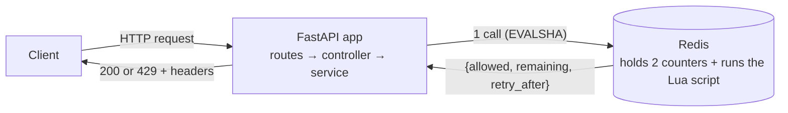
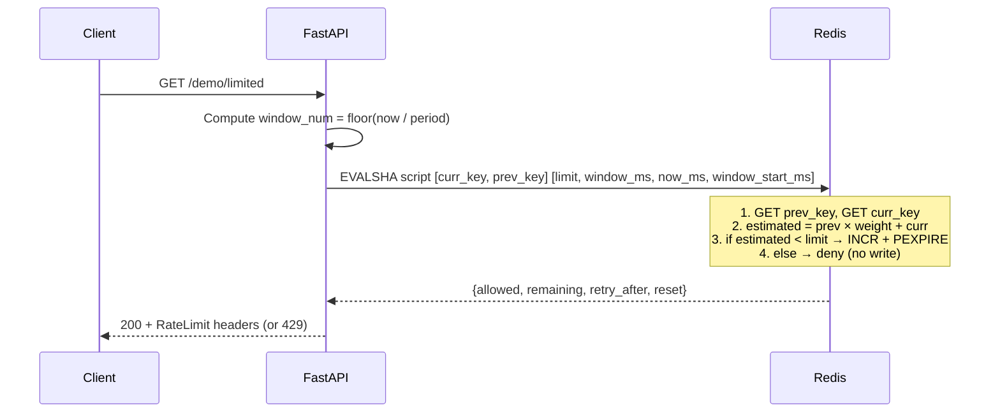

# Sliding Window Counter  ·  Cheap approximation of sliding-window rate limiting using two fixed-window counters

| | |
|---|---|
| **Engine** | Lua (Rule 2: read-compute-conditional-write must be atomic) |
| **Redis structure** | 2 × string (counters for current and previous window) |
| **Memory per identity** | O(1) — two small counter keys |
| **Accuracy** | Approximate (assumes previous window traffic was evenly distributed) |
| **Burst behaviour** | Much better than fixed window; no 2× edge spike |
| **Run it** | `make up P=sliding-counter` → http://localhost:8103 |

> **Use it when:** high-volume APIs where the sliding window log's O(limit) memory is too expensive, and "good enough" accuracy is fine.
> **Avoid it when:** you need exact guarantees (use the log) or explicit burst allowance (use token bucket/GCRA).

---

## 1. The idea in one picture

```text
Don't remember every guest, just "last hour we had 84, this hour so far 36."
Assume last hour's guests were evenly spread.

       previous window (84)               current window (36)
 ├──────────────────────────────────┤├─────────┬────────────────────────┤
                                       ▲
                                       now (15s in = 25% elapsed)

 sliding window = last 60s = [ last 45s of previous | first 15s of current ]
                               └──── 75% of previous ────┘

 estimated = 84 × 0.75 + 36 = 63 + 36 = 99
 One more request? 99 + 1 = 100 ≤ 100 → ✅
 After that?       ~100 + 1 > 100      → ⛔
```

## 2. Who does what



| Actor | Owns | Never does |
|---|---|---|
| App | Building the key, choosing rules, turning the answer into HTTP | Deciding allow/deny by itself |
| Redis | The two counters, the approximation formula, atomic decision | Knowing anything about HTTP |

## 3. What is stored in Redis

```text
KEY   rl:{user:alice}:api:swc:171     TYPE string   TTL ~120s (2 × window)
VALUE 36                               ← current window counter

KEY   rl:{user:alice}:api:swc:170     TYPE string   TTL ~45s (remaining overlap)
VALUE 84                               ← previous window counter
```

The window number is `floor(now_ms / window_ms)`. Each key expires after 2× the window period so it survives as the "previous" window for the next cycle.

## 4. Step-by-step with a worked example

Config: `limit = 100/min`

| Time | Previous (w170) | Current (w171) | Elapsed % | Weight | Estimated | Decision | Current after |
|---|---|---|---|---|---|---|---|
| 60.0s | 0 (empty) | 0 | 0% | 1.0 | 0 | ✅ | 1 |
| 60.5s | 0 | 1 | 0.8% | 0.99 | 1 | ✅ | 2 |
| ... | 0 | 99 | ~1% | ~0.99 | 99 | ✅ | 100 |
| 60.6s | 0 | 100 | 1% | 0.99 | 100 | ⛔ | 100 |
| ... window #171 fills with 84 ... |
| 120.0s | 84 (was w171) | 0 | 0% | 1.0 | 84 | ✅ | 1 |
| 135.0s | 84 | 36 | 25% | 0.75 | 63+36=99 | ✅ | 37 |
| 135.001s | 84 | 37 | 25% | 0.75 | 63+37=100 | ⛔ | 37 |

## 5. The request flow



## 6. Code map

| Folder | File | Read it to learn |
|---|---|---|
| `app/services/` | `rate_limiter_service.py` | The policy, in plain Python (no Redis, no FastAPI) |
| `app/repositories/` | `redis_repository.py` | How Redis is called: key derivation, EVALSHA |
| `app/lua/` | `sliding_window_counter.lua` | The atomic algorithm (annotated line by line) |
| `app/schemas/` | `rule.py`, `decision.py` | Input/output data types |
| `app/controllers/` | `rate_limit_controller.py` | FastAPI glue: identity → evaluate → HTTP headers |
| `app/routes/` | `demo.py`, `debug.py` | `/demo/limited` and `/debug/state` endpoints |

## 7. Why Lua

Cite: **Rule 2** from `docs/03-lua-vs-client-and-production.md` — "If the command sequence is read → decide → write, it must be atomic."

The sliding window counter reads two separate keys (previous and current counters), computes a weighted estimate, and then conditionally increments. Without Lua:

```python
# FLAWED: race condition between GET and INCR
prev = await redis.get(prev_key)     # Read
curr = await redis.get(curr_key)     # Read
estimated = prev * weight + curr     #
if estimated < limit:                # Decide
    await redis.incr(curr_key)       # Write ← another instance can slip in here!
```

Between the reads and the increment, another request can slip in. The Lua script runs all steps atomically inside Redis.

## 8. Run it

```bash
make up P=sliding-counter
curl -i localhost:8103/demo/limited
curl -i -H "X-User-Id: alice" localhost:8103/demo/limited
```

## 9. See it work

| # | Scenario | Command | Expected |
|---|---|---|---|
| 1 | Calm traffic | `make demo P=sliding-counter SCENARIO=steady` | all ✅ |
| 2 | Burst then abuse | `make demo P=sliding-counter SCENARIO=burst` | first N ✅, then ⛔ + Retry-After, then ✅ |
| 3 | Peek inside Redis | `make inspect` (second terminal) | Two counter keys with values and TTLs |
| 4 | Race demo | `python -m scripts.race_demo` (inside container) | Naive client leaks, Lua is exact |

## 10. Configuration

| Env var / field | Meaning | Default |
|---|---|---|
| `RL_LIMIT` | requests per period | 100 |
| `RL_PERIOD_SECONDS` | period length | 60 |
| `RL_BURST` | (unused for this algorithm; exists for schema compat) | = limit |
| `RL_FAIL_MODE` | `open` or `closed` | `open` |

## 11. Edge cases and failure modes

| Scenario | Behaviour |
|---|---|
| **Redis down** | Fail-open: request allowed (configurable) |
| **Previous window empty** | weight × 0 = 0; counter acts like a single fixed window |
| **Long idle** | Both counters expire (TTL = 2 × window); fresh start |
| **Very high request rates** | O(1) per evaluation — just GET + GET + INCR |
| **Clock jumps** | Uses Redis `TIME` inside Lua, not app-server clocks |
| **Approximation error** | Assumes previous window traffic was evenly spread; real-world error is typically < 1% |

## 12. Plug it into your app

1. Copy `app/services/`, `app/repositories/`, `app/lua/`, `app/schemas/`
2. Dependencies: `redis>=5`, `fastapi`, `pydantic`
3. Wire it:
   ```python
   from app.services.rate_limiter_service import RateLimiterService
   from app.repositories.redis_repository import RedisRepository
   from app.schemas.rule import Rule

   limiter = RateLimiterService(RedisRepository(redis_client))
   rule = Rule(name="api:sec", limit=100, period=60)
   decision = await limiter.evaluate("user:alice", rule)
   ```

## 13. Trade-offs

| Strength | Weakness |
|---|---|
| O(1) memory — two tiny counters vs O(limit) for sliding log | Approximate — assumes even distribution in previous window |
| No boundary spike (unlike fixed window) | Retry-After is approximate (not exact like the log) |
| Very fast: 3 Redis commands inside Lua | No explicit burst control (use token bucket/GCRA for that) |
| Natural extension of fixed window — easy to explain | Accuracy degrades with very bursty traffic in previous window |

## 14. Go deeper

- `docs/02-algorithms.md#4-sliding-window-counter` — full explanation with diagrams
- `docs/03-lua-vs-client-and-production.md` — why Lua, when client-side is enough
- [Cloudflare blog: How we built rate limiting capable of scaling to millions of domains](https://blog.cloudflare.com/counting-things-a-lot-of-different-things/) — uses this exact algorithm at scale
