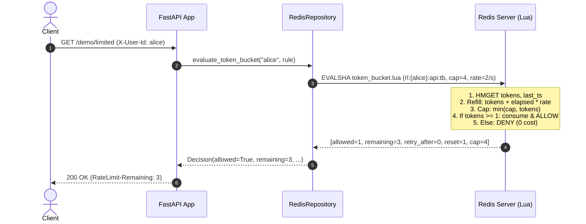
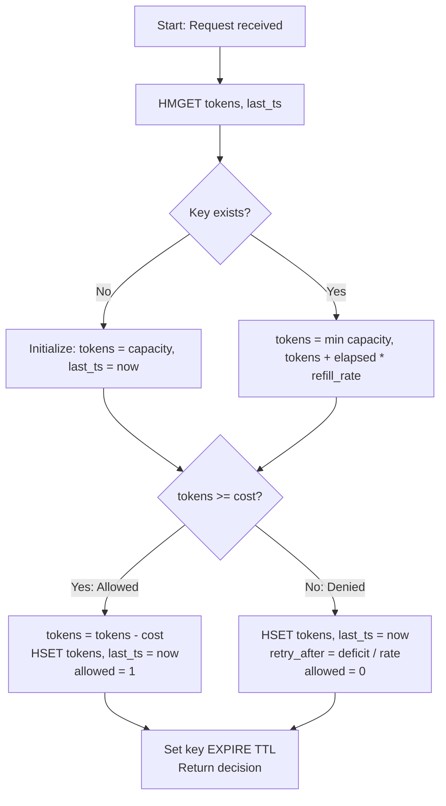
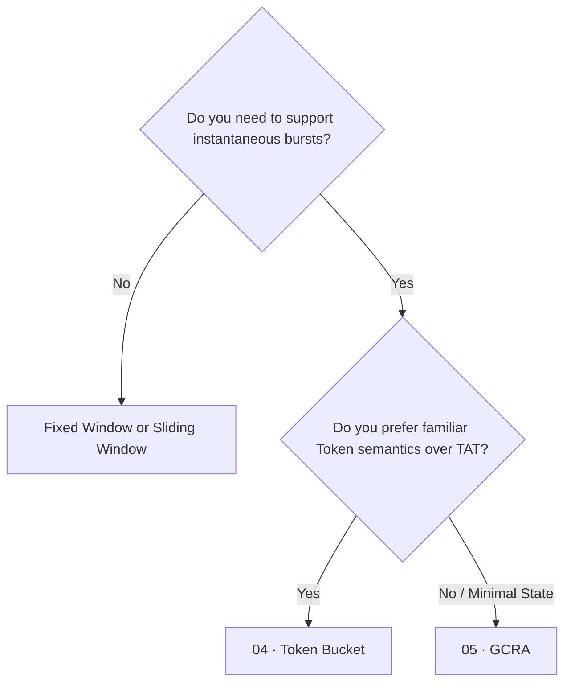

# Token Bucket  ·  Classic rate limiter allowing burst capacity with steady continuous token refill

| | |
|---|---|
| **Engine** | Lua (`token_bucket.lua`) — Rule 2: read-compute-write on multiple fields must be atomic |
| **Redis structure** | Hash (`rl:{identity}:{rule}:tb` with fields `tokens` and `last_ts`) |
| **Memory per key** | O(1): ~100 bytes (single small Redis hash) |
| **Accuracy** | Exact (continuous time lazy refill) |
| **Burst handling** | Explicit: bucket capacity controls peak instantaneous burst size; refill rate controls sustained throughput |
| **RFC compliance** | Emits standard `RateLimit-Limit`, `RateLimit-Remaining`, `RateLimit-Reset`, and `Retry-After` headers |

---

## 1. The Analogy

Imagine a bucket under a slow dripping faucet:
- The bucket holds at most **$B$ tokens** (its capacity).
- Water drips continuously at a steady refill rate **$r$ tokens per second**.
- When a user arrives, each request **takes one token** out of the bucket.
- If the bucket has at least 1 token, the request is allowed immediately.
- If the user clicks 5 times in a millisecond, they can grab up to 5 tokens at once (a **burst**).
- Once the bucket is dry (0 tokens), subsequent requests are denied until enough water drips in.
- If the user disappears for hours, the bucket simply sits full at capacity $B$; it does **not** overflow or hoard extra tokens.

```text
       💧 refill: r tokens / second (e.g. 2 / s)
        │
   ┌────▼────┐   Bucket capacity: B = 4 tokens
   │ ● ● ● ● │   ◄── Each incoming request takes 1 token (●)
   └─────────┘
   Empty bucket? ⛔ 429 Too Many Requests (wait for refill)
```

---

## 2. Who Does What



---

## 3. How It Works (Lazy Refill)

Instead of running background timers or cron jobs in Redis to inject tokens every millisecond, token bucket calculates refill **lazily on demand** when a request arrives:

$$\text{refilled} = \frac{\text{now} - \text{last\_ts}}{1000} \times \text{refill\_rate}$$

$$\text{tokens}_{\text{current}} = \min(\text{capacity},\ \text{tokens}_{\text{previous}} + \text{refilled})$$

If $\text{tokens}_{\text{current}} \ge \text{cost}$:
- The request is **allowed**.
- New tokens balance: $\text{tokens}_{\text{current}} - \text{cost}$.
- Timestamp $\text{last\_ts}$ is updated to $\text{now}$.

If $\text{tokens}_{\text{current}} < \text{cost}$:
- The request is **denied** with HTTP 429.
- **Denied requests consume nothing:** tokens balance remains intact.
- Timestamp $\text{last\_ts}$ is updated to $\text{now}$ so elapsed refill isn't recalculated repeatedly.
- $\text{Retry-After} = \lceil \frac{\text{cost} - \text{tokens}_{\text{current}}}{\text{refill\_rate}} \rceil$.

---

## 4. Redis Data Structure

A single Redis **Hash** per identity and rule:

```text
KEY: rl:{alice}:demo_token_bucket:tb
TYPE: hash
TTL:  60s (auto-refreshed on every evaluation)

FIELDS:
  "tokens"  -> "2.75"           (floating-point token balance)
  "last_ts" -> "1714000000500"  (millisecond timestamp of last evaluation)
```

---

## 5. Lua Script Anatomy (Why Lua is Required)



### The Race Condition in Naive Client Implementations (Rule 2)
If implemented on the client (FastAPI):
1. Client 1 reads hash: `tokens = 1.0`.
2. Client 2 reads hash: `tokens = 1.0`.
3. Client 1 computes `1.0 >= 1`, sets `tokens = 0.0` and allows.
4. Client 2 computes `1.0 >= 1`, sets `tokens = 0.0` and allows.
Both allowed the request even though only 1 token was available!

Under 200 concurrent callers, naive client read-then-write leaks up to 200 requests. Lua executes atomically inside Redis single-threaded engine, ensuring **exactly** the configured burst limit is allowed.

---

## 6. Worked Example

Configuration: **Capacity $B = 4$, Refill rate $r = 2$ tokens/s**. Alice starts with a full bucket:

| Time (s) | Request | Tokens before (after lazy refill) | Decision | Tokens after | Retry-After |
|---|---|---|---|---|---|
| `0.00` | #1 | 4.0 | ✅ 200 | 3.0 | - |
| `0.00` | #2 | 3.0 | ✅ 200 | 2.0 | - |
| `0.00` | #3 | 2.0 | ✅ 200 | 1.0 | - |
| `0.00` | #4 | 1.0 | ✅ 200 | 0.0 | - |
| `0.00` | #5 | 0.0 | ⛔ 429 | 0.0 | 1s |
| `0.50` | #6 | $0 + 0.5 \times 2 = 1.0$ | ✅ 200 | 0.0 | - |
| `5.00` | #7 | $\min(4, 0 + 4.5 \times 2) = \mathbf{4.0}$ | ✅ 200 | 3.0 | - |

---

## 7. Decision Tree: When to Use / When to Avoid



### Use it when:
- You want to decouple sustained rate (e.g. 10 req/s) from peak burst tolerance (e.g. 50 req burst).
- Your API pricing or documentation uses token terminology ("100 tokens per minute").
- You need weighted requests (e.g. heavy search endpoint costs 5 tokens, ping costs 1).

### Avoid it when:
- You need strict rolling log inspection without bursts (use `02_sliding_window_log`).
- You want to store only a single number instead of a hash (use `05_gcra`).

---

## 8. HTTP Contract & Response Headers

### 200 OK (Allowed)
```http
HTTP/1.1 200 OK
Content-Type: application/json
RateLimit-Limit: 5
RateLimit-Remaining: 4
RateLimit-Reset: 1
```

### 429 Too Many Requests (Rate Limited)
```http
HTTP/1.1 429 Too Many Requests
Content-Type: application/json
Retry-After: 1
RateLimit-Limit: 5
RateLimit-Remaining: 0
RateLimit-Reset: 1

{
  "detail": {
    "error": "rate_limited",
    "rule": "demo_token_bucket",
    "retry_after_seconds": 1
  }
}
```

---

## 9. Failure Modes & Edge Cases

| Scenario | Behavior | Mitigation |
|---|---|---|
| **Redis downtime** | Fail open (allow request) or fail closed (deny) | Controlled via `RL_FAIL_MODE` setting |
| **Clock skew / backwards time** | `elapsed_ms = math.max(0, now - last_ts)` prevents negative refills | Safe guard in Lua script |
| **Idle key accumulation** | Memory leak if millions of unique clients connect once | Key TTL automatically refreshed to $2 \times \text{fill\_time}$ on every call |
| **Extreme idle hoarding** | Client dormant for 1 week should not get millions of tokens | Refill capped with `math.min(capacity, ...)` |

---

## 10. Concurrency & Race Condition Demo

Run the automated race condition test:

```bash
docker compose run --rm dev python rate_limiters/algorithms/04_token_bucket/scripts/race_demo.py
```

Expected output:
```text
=================================================================
 RACE CONDITION DEMO: Naive Client Check vs Atomic Lua Script
 Algorithm: Token Bucket (burst capacity + lazy refill)
 Limit: 10 burst capacity · Concurrency: 200 parallel callers
=================================================================

Engine                         Intended Limit   Actual Allowed   Result
───────────────────────────────────────────────────────────────────────────
Naive Client (Read-Then-Write) 10               200              ⛔ LEAKY (RACE)
Atomic Lua (HMGET + HSET)      10               10               ✅ EXACT
───────────────────────────────────────────────────────────────────────────
```

---

## 11. See It Work

### 1. Start the service
```bash
make up P=token-bucket
```

### 2. Run the demo script
```bash
./rate_limiters/algorithms/04_token_bucket/scripts/demo.sh
```

### 3. Observe Redis state live
```bash
make inspect
```

---

## 12. Code Map

```text
rate_limiters/algorithms/04_token_bucket/
├── README.md
├── app/
│   ├── config.py                     # Limit, period, burst settings
│   ├── controllers/
│   │   └── rate_limit_controller.py  # Translates requests into decisions & RFC headers
│   ├── lua/
│   │   └── token_bucket.lua          # Atomic lazy refill and token deduction in Redis
│   ├── main.py                       # FastAPI entrypoint, lifespan, health/metrics
│   ├── observability/
│   │   └── metrics.py                # Prometheus latency & decision counters
│   ├── repositories/
│   │   └── redis_repository.py       # Executes Lua script and inspects Hash state
│   ├── routes/
│   │   ├── debug.py                  # /debug/state inspection
│   │   └── demo.py                   # /demo/limited endpoint
│   ├── schemas/
│   │   ├── decision.py               # Decision dataclass
│   │   └── rule.py                   # Rule definition with burst & cost
│   └── services/
│       ├── identity.py               # Header-based identity resolution
│       └── rate_limiter_service.py   # Pure business logic (0 FastAPI/Redis imports)
├── scripts/
│   ├── demo.sh                       # Quick bash test script
│   └── race_demo.py                  # 200-caller concurrency demonstration
└── tests/
    ├── test_concurrency_race.py      # 200 parallel callers invariant test
    ├── test_script_invariants.py     # Live Redis TTL, lazy refill, and cap invariants
    └── test_unit_service.py          # Pure unit tests with in-memory FakeRepository
```

---

## 13. Production Checklist

- [x] Redis key tagged on `{identity}` only (`rl:{identity}:...`) for Redis Cluster compatibility
- [x] Redis `TIME` used to avoid host clock drift
- [x] Key TTL set to allow idle keys to self-evict
- [x] Denied requests cost 0 tokens
- [x] Pure service layer without framework or database dependencies
- [x] RFC 6585 and draft-ietf-httpapi-ratelimit headers returned

---

## 14. References

- [IETF RateLimit Header Fields for HTTP](https://datatracker.ietf.org/doc/draft-ietf-httpapi-ratelimit-headers/)
- [RFC 6585: Additional HTTP Status Codes (429)](https://datatracker.ietf.org/doc/html/rfc6585)
- [Redis HASH documentation](https://redis.io/docs/latest/commands/?group=hash)
