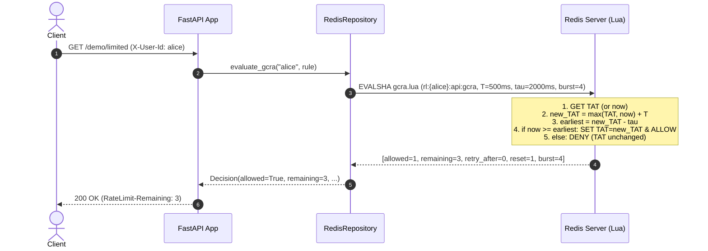
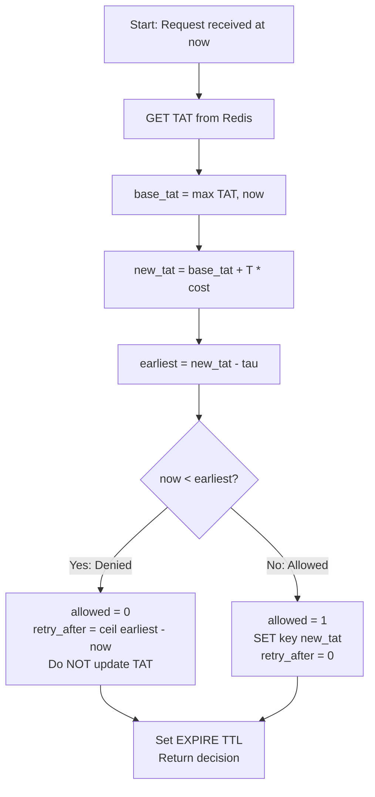
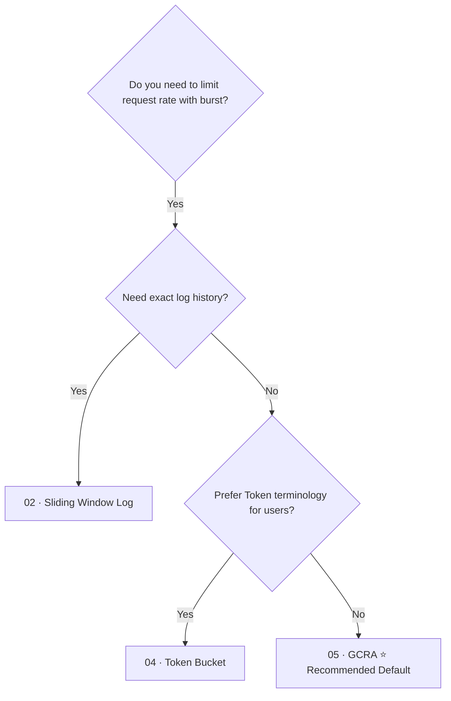

# GCRA (Generic Cell Rate Algorithm)  ·  Recommended default rate limiter storing TAT in a single Redis string

| | |
|---|---|
| **Engine** | Lua (`gcra.lua`) — Rule 2: read-compute-write on TAT must be atomic |
| **Redis structure** | String (`rl:{identity}:{rule}:gcra` storing integer millisecond TAT) |
| **Memory per key** | O(1): ~60 bytes (smallest possible state for burst-tolerant rate limiting) |
| **Accuracy** | Exact (continuous time Theoretical Arrival Time arithmetic) |
| **Burst handling** | Explicit: burst tolerance $\tau = T \times \text{burst}$ |
| **RFC compliance** | Emits standard `RateLimit-Limit`, `RateLimit-Remaining`, `RateLimit-Reset`, and exact `Retry-After` headers |

---

## 1. The Analogy

Imagine a ticket dispenser for a theme park ride:
- The machine prints a timestamp for the **next available slot** called the **TAT** (*Theoretical Arrival Time*).
- Each visitor pushes the slot forward by an emission interval $T$ (e.g. 500 ms per visitor).
- You are allowed to take tickets for future slots, but you cannot book more than a fixed distance ahead into the future (the burst tolerance $\tau = 2000\text{ ms}$).
- If you request a ticket and the next free slot would push past the horizon ($now + \tau$), you are **denied** with a polite message: *"Please wait until the horizon clears"* (exact `Retry-After`).
- If nobody arrives for hours, the machine's clock doesn't rewind into ancient history; when a new visitor arrives, the slot starts freshly from `now`.

```text
time ────────────────────────────────────────────────────────►
      0ms        500ms       1000ms      1500ms      2000ms      2500ms
clock ▼
      │
TAT   ● after #1 = 500ms
      ●────────── after #2 = 1000ms
      ●────────────────────── after #3 = 1500ms
      ●────────────────────────────────── after #4 = 2000ms   ◄── Horizon reached (τ = 2000ms)
 #5 at t=0 would push TAT to 2500ms → 2500 - 0 > 2000 ⛔ DENIED (retry in 500ms)
 #6 at t=500ms: TAT 2500 - 500 = 2000 ≤ 2000 ✅ ALLOWED
```

---

## 2. Who Does What



---

## 3. How It Works (The Mathematics of TAT)

GCRA is **token bucket in disguise, but stores only a single integer number**:

1. **$T$ (Emission Interval)**: The time separation between sustained requests.
   $$T = \frac{\text{period\_seconds} \times 1000}{\text{limit}}\quad (\text{ms})$$
2. **$\tau$ (Burst Tolerance)**: How far ahead of the current clock the TAT is allowed to advance.
   $$\tau = T \times \text{burst}\quad (\text{ms})$$
3. **$\text{TAT}$ (Theoretical Arrival Time)**: The single stored timestamp in Redis.

### The Decision Rule
When a request arrives at wall-clock time $\text{now}$:

$$\text{base\_TAT} = \max(\text{TAT},\ \text{now})$$
$$\text{new\_TAT} = \text{base\_TAT} + (T \times \text{cost})$$
$$\text{earliest\_allowed} = \text{new\_TAT} - \tau$$

- **If $\text{now} < \text{earliest\_allowed}$:**
  - ⛔ **DENIED**: The request arrives too early.
  - **Denied requests consume nothing:** $\text{TAT}$ is **not** modified.
  - $\text{Retry-After} = \lceil \frac{\text{earliest\_allowed} - \text{now}}{1000} \rceil$ seconds.
- **If $\text{now} \ge \text{earliest\_allowed}$:**
  - ✅ **ALLOWED**: Advance stored $\text{TAT} = \text{new\_TAT}$.
  - $\text{Retry-After} = 0$.

### Remaining and Reset
- $\text{available\_time} = \max(0,\ (\text{now} + \tau) - \text{TAT})$
- $\text{remaining} = \min(\text{burst},\ \lfloor \frac{\text{available\_time}}{T} \rfloor)$
- $\text{reset\_seconds} = \lceil \frac{\max(0,\ \text{TAT} - \text{now})}{1000} \rceil$

---

## 4. Redis Data Structure

A single Redis **String** storing the integer timestamp:

```text
KEY:   rl:{alice}:demo_gcra:gcra
TYPE:  string
VALUE: "1714000002000"     (millisecond Unix timestamp of TAT)
TTL:   60s (auto-refreshed to time-until-recovered + buffer)
```

---

## 5. Lua Script Anatomy (Why Lua is Required)



### The Race Condition in Naive Client Implementations (Rule 2)
If implemented naively in application code (FastAPI):
1. Client 1 reads `TAT = 0`.
2. Client 2 reads `TAT = 0`.
3. Client 1 computes `new_tat = 500`, writes `SET TAT 500` and allows.
4. Client 2 computes `new_tat = 500`, writes `SET TAT 500` and allows.
Both callers advanced TAT from the same base! Under 200 concurrent requests, the naive client allows all 200 requests through a burst limit of 10.

The atomic Lua script performs `GET`, arithmetic comparison, and conditional `SET` in a single Redis transaction.

---

## 6. Worked Example

Configuration: **Limit 2 req/s, Burst 4** $\rightarrow T = 500\text{ ms}$, $\tau = 4 \times 500 = 2000\text{ ms}$.
All times in milliseconds relative to $t=0$:

| Now | Request | TAT before | new_TAT = max(TAT, now)+500 | earliest = new_TAT − 2000 | now < earliest? | Result | TAT stored | Remaining |
|---|---|---|---|---|---|---|---|---|
| `0` | #1 | 0 | 500 | −1500 | No | ✅ 200 | 500 | 3 |
| `0` | #2 | 500 | 1000 | −1000 | No | ✅ 200 | 1000 | 2 |
| `0` | #3 | 1000 | 1500 | −500 | No | ✅ 200 | 1500 | 1 |
| `0` | #4 | 1500 | 2000 | 0 | No | ✅ 200 | 2000 | 0 |
| `0` | #5 | 2000 | 2500 | **500** | **Yes** | ⛔ 429 | **2000** | 0 |
| `500`| #6 | 2000 | 2500 | 500 | No | ✅ 200 | 2500 | 0 |

---

## 7. Decision Tree: When to Use / When to Avoid



### Use it when:
- **Default choice:** You need reliable, burst-tolerant rate limiting with minimal memory footprint.
- You want the simplest Redis storage (single integer string per limiter).
- You need exact, mathematically clean `Retry-After` seconds.
- You want to support weighted requests (`cost > 1`).

### Avoid it when:
- You need to limit **concurrent in-flight** tasks rather than arrival rates (use `06_concurrency`).
- Stakeholders require token balances in API docs (token bucket provides equivalent behavior).

---

## 8. HTTP Contract & Response Headers

### 200 OK (Allowed)
```http
HTTP/1.1 200 OK
Content-Type: application/json
RateLimit-Limit: 5
RateLimit-Remaining: 4
RateLimit-Reset: 1
```

### 429 Too Many Requests (Rate Limited)
```http
HTTP/1.1 429 Too Many Requests
Content-Type: application/json
Retry-After: 1
RateLimit-Limit: 5
RateLimit-Remaining: 0
RateLimit-Reset: 1

{
  "detail": {
    "error": "rate_limited",
    "rule": "demo_gcra",
    "retry_after_seconds": 1
  }
}
```

---

## 9. Failure Modes & Edge Cases

| Scenario | Behavior | Mitigation |
|---|---|---|
| **Redis downtime** | Fail open (allow request) or fail closed (deny) | Configurable via `RL_FAIL_MODE` |
| **Clock skew / backwards clock** | Redis `TIME` used in Lua script | Server clock consistency guaranteed |
| **Idle key growth** | Idle keys consume memory indefinitely | Auto-expiry TTL (`reset_sec + 60s`) |
| **Excessive idle hoarding** | Client dormant for days should not get infinite requests | `max(TAT, now)` snaps TAT forward to `now` |

---

## 10. Concurrency & Race Condition Demo

Run the automated race demonstration:

```bash
docker compose run --rm dev python rate_limiters/algorithms/05_gcra/scripts/race_demo.py
```

Expected output:
```text
=================================================================
 RACE CONDITION DEMO: Naive Client Check vs Atomic Lua Script
 Algorithm: GCRA (Generic Cell Rate Algorithm / TAT)
 Limit: 10 burst capacity · Concurrency: 200 parallel callers
=================================================================

Engine                         Intended Limit   Actual Allowed   Result
───────────────────────────────────────────────────────────────────────────
Naive Client (Read-Then-Write) 10               200              ⛔ LEAKY (RACE)
Atomic Lua (GET + SET)         10               10               ✅ EXACT
───────────────────────────────────────────────────────────────────────────
```

---

## 11. See It Work

### 1. Start the service
```bash
make up P=gcra
```

### 2. Run the demo script
```bash
./rate_limiters/algorithms/05_gcra/scripts/demo.sh
```

### 3. Observe Redis TAT state live
```bash
make inspect
```

---

## 12. Code Map

```text
rate_limiters/algorithms/05_gcra/
├── README.md
├── app/
│   ├── config.py                     # Limit, period, burst settings
│   ├── controllers/
│   │   └── rate_limit_controller.py  # Translates requests into decisions & RFC headers
│   ├── lua/
│   │   └── gcra.lua                  # Atomic TAT arithmetic and evaluation
│   ├── main.py                       # FastAPI entrypoint, lifespan, health/metrics
│   ├── observability/
│   │   └── metrics.py                # Prometheus latency & decision counters
│   ├── repositories/
│   │   └── redis_repository.py       # Executes Lua script and inspects string TAT state
│   ├── routes/
│   │   ├── debug.py                  # /debug/state inspection
│   │   └── demo.py                   # /demo/limited endpoint
│   ├── schemas/
│   │   ├── decision.py               # Decision dataclass
│   │   └── rule.py                   # Rule definition with burst & cost
│   └── services/
│       ├── identity.py               # Header-based identity resolution
│       └── rate_limiter_service.py   # Pure business logic (0 FastAPI/Redis imports)
├── scripts/
│   ├── demo.sh                       # Quick bash test script
│   └── race_demo.py                  # 200-caller concurrency demonstration
└── tests/
    ├── test_concurrency_race.py      # 200 parallel callers invariant test
    ├── test_script_invariants.py     # Live Redis TTL, TAT recovery, and denial invariants
    └── test_unit_service.py          # Pure unit tests with in-memory FakeRepository
```

---

## 13. Production Checklist

- [x] Redis key tagged on `{identity}` only (`rl:{identity}:...`) for Redis Cluster hash slots
- [x] Redis `TIME` used in Lua to avoid client clock drift
- [x] Key TTL set to allow idle keys to self-evict
- [x] Denied requests cost 0 (TAT never modified on denial)
- [x] Pure service layer without framework or database dependencies
- [x] RFC 6585 and draft-ietf-httpapi-ratelimit headers returned

---

## 14. References

- [IETF RateLimit Header Fields for HTTP](https://datatracker.ietf.org/doc/draft-ietf-httpapi-ratelimit-headers/)
- [RFC 6585: Additional HTTP Status Codes (429)](https://datatracker.ietf.org/doc/html/rfc6585)
- [ATM Forum Traffic Management Specification (GCRA definition)](https://en.wikipedia.org/wiki/Generic_cell_rate_algorithm)
