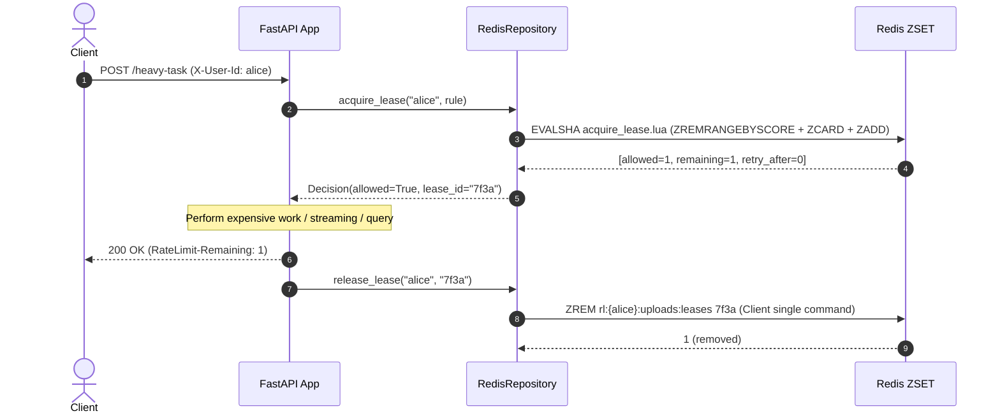
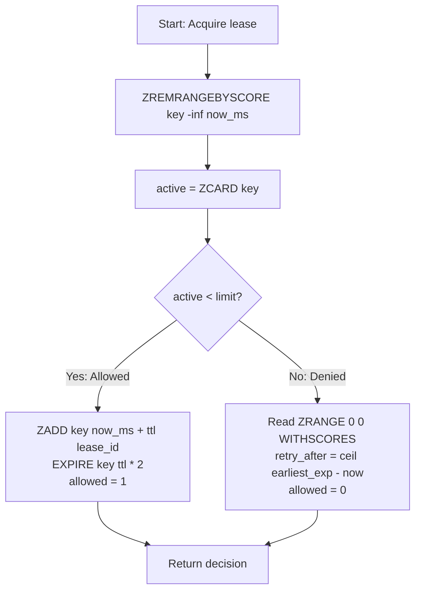
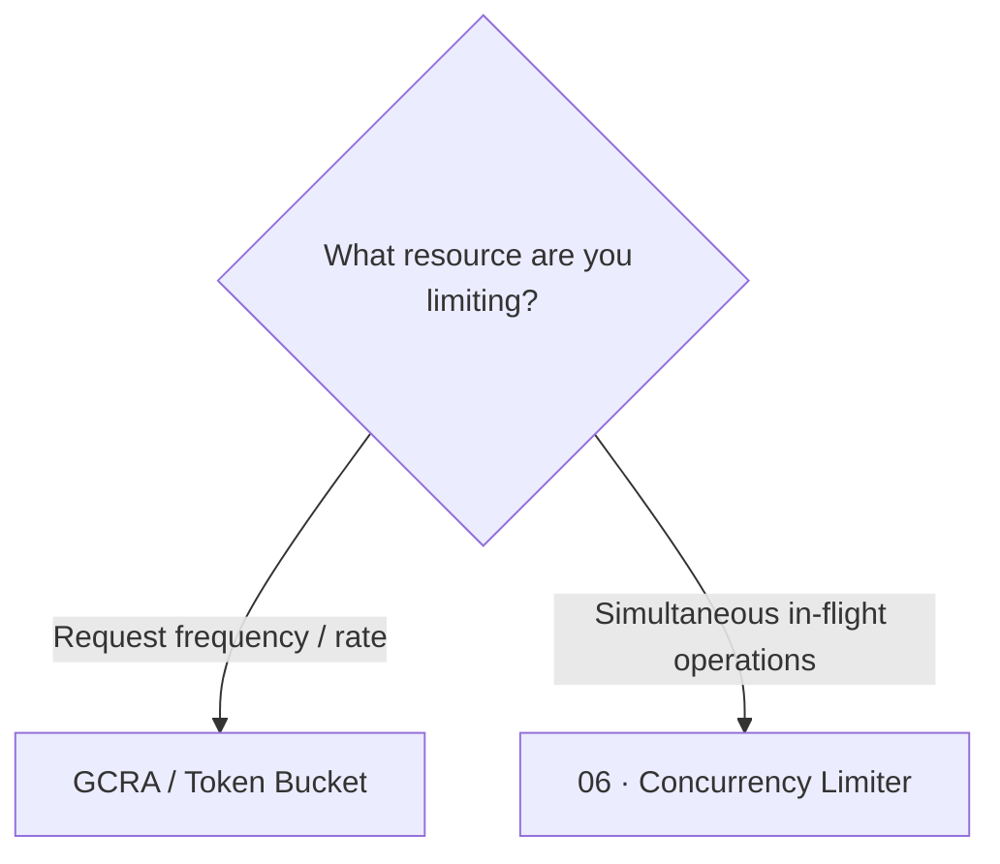

# Concurrency Limiter (Leases)  ·  Limit simultaneous in-flight work with automatic crash recovery

| | |
|---|---|
| **Engine** | **Lua** for `acquire` (Rule 2: clean expired + count + conditional add) · **Client** for `release` (Rule 1: single `ZREM`) |
| **Redis structure** | ZSET (`rl:{identity}:{rule}:leases` where score = millisecond expiry time) |
| **Memory per key** | O(concurrent leases) — negligible (~100 bytes per active lease) |
| **Accuracy** | Exact while leases are valid |
| **Burst handling** | N/A — measures active parallelism, not request frequency |
| **RFC compliance** | Emits standard `RateLimit-Limit`, `RateLimit-Remaining`, `RateLimit-Reset`, and `Retry-After` headers |

---

## 1. The Analogy

Imagine a parking lot with only **$N$ spaces**:
- Cars take a ticket and enter a space. When they finish and drive out, the space is returned immediately.
- If a driver abandons a car or crashes inside the lot (worker failure), the space would normally be occupied forever.
- To prevent permanent lockouts, every parking ticket has an **expiration time** (a lease TTL).
- When a new car arrives at the gate, the automated booth first scans the lot for expired tickets, tows abandoned cars away, and counts remaining empty spaces.
- If spaces are available, the car is allowed in. If the lot is truly full of active cars, the driver is turned away: *"Please come back in $X$ seconds when the earliest ticket expires"*.

```text
       Limit = 2 concurrent slots
   ┌─────────────────────────────────┐
   │ [Space 1: Job A (exp t+30s)]    │  ◄── Occupied
   │ [Space 2: Job B (exp t+45s)]    │  ◄── Occupied
   └─────────────────────────────────┘
   Incoming Job C? ⛔ 429 Full! (Wait for release or earliest expiry)
```

---

## 2. Who Does What



---

## 3. How It Works (Lease Expiration and Crash Recovery)

Unlike rate limiters (which measure requests per second), the concurrency limiter measures **in-flight active work**:

1. **Lease Acquisition (Atomic Lua)**:
   - When a job starts, it requests a lease with a unique ID and validity duration (e.g. 30 seconds).
   - In Redis:
     1. Clean expired entries: `ZREMRANGEBYSCORE key -inf now`.
     2. Count remaining active entries: `ZCARD key`.
     3. If `active < limit`: Add lease with score = `now + lease_ttl` via `ZADD`.
     4. If `active >= limit`: Deny request with `Retry-After = earliest_expiry - now`.
2. **Lease Release (Client `ZREM`)**:
   - When the request completes (or fails with an unhandled exception), the application executes a single `ZREM key lease_id`.
   - `ZREM` is completely **idempotent**: releasing an already-expired or non-existent lease does nothing and cannot corrupt the count.
3. **Crash Recovery (Automatic Self-Healing)**:
   - If a worker crashes (`kill -9`, OOM, network partition), it never calls `release`.
   - The slot is not leaked forever: as soon as the lease TTL passes, the very next `acquire` cleans it out automatically.

---

## 4. Redis Data Structure

A single Redis **Sorted Set (ZSET)** per identity and rule:

```text
KEY:   rl:{alice}:demo_concurrency:leases
TYPE:  zset
TTL:   60s (auto-refreshed on every evaluation)

MEMBERS & SCORES:
  Score (Expiry Timestamp ms)     Member (Lease ID)
  ───────────────────────────     ─────────────────
  1714000030000                   "lease_4b8f09"
  1714000045000                   "lease_e21a8c"
```

---

## 5. Lua Script Anatomy (Why Lua for Acquire, Client for Release)

### Acquire: Rule 2 (Read-Compute-Write on Multiple Operations)


If acquire were performed client-side:
1. Client 1 calls `ZCARD` $\rightarrow 1$ (limit 2).
2. Client 2 calls `ZCARD` $\rightarrow 1$ (limit 2).
3. Client 1 calls `ZADD` $\rightarrow$ count is now 2.
4. Client 2 calls `ZADD` $\rightarrow$ count is now 3 (over capacity!).

### Release: Rule 1 (Single Direct Command)
Release does not need Lua: a single `ZREM key lease_id` is natively atomic in Redis.

---

## 6. Worked Example (The Crash Recovery Scenario)

Configuration: **Limit = 2 concurrent slots**, Lease TTL = 30 seconds:

| Time | Event | ZSET State (Lease + Expiry) | Active Count | Result | Note |
|---|---|---|---|---|---|
| `t=0` | Acquire Job A | `{ A: 30 }` | 1 | ✅ Allowed | Space 1 taken |
| `t=5` | Acquire Job B | `{ A: 30, B: 35 }` | 2 | ✅ Allowed | Space 2 taken (Full) |
| `t=10` | Acquire Job C | `{ A: 30, B: 35 }` | 2 | ⛔ Denied | Retry in 20s (earliest: A at t=30) |
| `t=12` | **Worker A crashes 💥** | `{ A: 30, B: 35 }` | 2 | - | Never calls release! |
| `t=15` | Acquire Job C | `{ A: 30, B: 35 }` | 2 | ⛔ Denied | A has not expired yet |
| `t=31` | Acquire Job C | `{ B: 35, C: 61 }` | 2 | ✅ Allowed | **A expired at t=30** $\rightarrow$ cleaned $\rightarrow$ slot given to C! |
| `t=32` | Worker B finishes | `{ C: 61 }` | 1 | - | B calls `ZREM` normally |

---

## 7. Decision Tree: When to Use / When to Avoid



### Use it when:
- Heavy LLM generation / token streaming endpoints.
- CPU/RAM-heavy file uploads, report generators, image/video transcoding.
- Protecting downstream databases from connection pool exhaustion.

### Avoid it when:
- You want to restrict how many total requests a user can make per hour (use `05_gcra`).
- Tasks cannot be bounded by a predictable lease timeout.

---

## 8. HTTP Contract & Response Headers

### 200 OK (Lease Granted)
```http
HTTP/1.1 200 OK
Content-Type: application/json
RateLimit-Limit: 2
RateLimit-Remaining: 1
RateLimit-Reset: 0
```

### 429 Too Many Requests (Concurrency Full)
```http
HTTP/1.1 429 Too Many Requests
Content-Type: application/json
Retry-After: 15
RateLimit-Limit: 2
RateLimit-Remaining: 0
RateLimit-Reset: 15

{
  "detail": {
    "error": "rate_limited",
    "rule": "demo_concurrency",
    "retry_after_seconds": 15
  }
}
```

---

## 9. Failure Modes & Edge Cases

| Scenario | Behavior | Mitigation |
|---|---|---|
| **Worker crash holding lease** | Lease abandoned in Redis | Automatically cleaned on next acquire after lease TTL |
| **Job takes longer than lease** | Slot freed prematurely while job runs | Tune lease TTL to exceed max duration or send periodic renewal heartbeats |
| **Redis downtime** | Fail open or fail closed | Configurable via `RL_FAIL_MODE` |
| **Idle key accumulation** | Empty ZSET remains in memory | Key TTL automatically refreshed to $2 \times \text{lease\_ttl}$ |

---

## 10. Concurrency & Race Condition Demo

Run the automated race demonstration:

```bash
docker compose run --rm dev python rate_limiters/algorithms/06_concurrency/scripts/race_demo.py
```

Expected output:
```text
=================================================================
 RACE CONDITION DEMO: Naive Client Check vs Atomic Lua Script
 Algorithm: Concurrency Limiter (in-flight lease management)
 Limit: 10 concurrent slots · Concurrency: 200 parallel callers
=================================================================

Engine                         Intended Limit   Actual Allowed   Result
───────────────────────────────────────────────────────────────────────────
Naive Client (ZCARD then ZADD) 10               200              ⛔ LEAKY (RACE)
Atomic Lua (Clean + Count + ZADD) 10            10               ✅ EXACT
───────────────────────────────────────────────────────────────────────────
```

---

## 11. See It Work

### 1. Start the service
```bash
make up P=concurrency
```

### 2. Run the demo script
```bash
./rate_limiters/algorithms/06_concurrency/scripts/demo.sh
```

### 3. Observe active leases in Redis
```bash
make inspect
```

---

## 12. Code Map

```text
rate_limiters/algorithms/06_concurrency/
├── README.md
├── app/
│   ├── config.py                     # Limit and lease_ttl settings
│   ├── controllers/
│   │   └── rate_limit_controller.py  # Dependency with yield/finally lease cleanup
│   ├── lua/
│   │   └── acquire_lease.lua         # Atomic expired cleanup, count, and ZADD
│   ├── main.py                       # FastAPI entrypoint, lifespan, health/metrics
│   ├── observability/
│   │   └── metrics.py                # Prometheus latency & decision counters
│   ├── repositories/
│   │   └── redis_repository.py       # Lua acquire + client ZREM release
│   ├── routes/
│   │   ├── debug.py                  # /debug/state inspection of active leases
│   │   └── demo.py                   # /demo/limited endpoint
│   ├── schemas/
│   │   ├── decision.py               # Decision with lease_id
│   │   └── rule.py                   # Rule with limit & lease_ttl_seconds
│   └── services/
│       ├── identity.py               # Header-based identity resolution
│       └── rate_limiter_service.py   # Pure business logic (0 FastAPI/Redis imports)
├── scripts/
│   ├── demo.sh                       # Quick bash test script
│   └── race_demo.py                  # 200-caller concurrency demonstration
└── tests/
    ├── test_concurrency_race.py      # 200 parallel callers invariant test
    ├── test_script_invariants.py     # Live Redis crash recovery and ZREM tests
    └── test_unit_service.py          # Pure unit tests with in-memory FakeRepository
```

---

## 13. Production Checklist

- [x] Redis key tagged on `{identity}` only (`rl:{identity}:...`) for Redis Cluster compatibility
- [x] Expired leases cleaned atomically on every acquire
- [x] Client `release` is idempotent via `ZREM`
- [x] Key TTL set to allow idle keys to self-evict
- [x] Denied requests never add leases to Redis
- [x] Pure service layer without framework or database dependencies
- [x] RFC 6585 and draft-ietf-httpapi-ratelimit headers returned

---

## 14. References

- [Redis Sorted Sets Documentation](https://redis.io/docs/latest/commands/?group=sorted-set)
- [IETF RateLimit Header Fields for HTTP](https://datatracker.ietf.org/doc/draft-ietf-httpapi-ratelimit-headers/)
- [RFC 6585: Additional HTTP Status Codes (429)](https://datatracker.ietf.org/doc/html/rfc6585)
