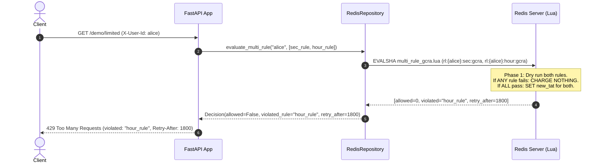
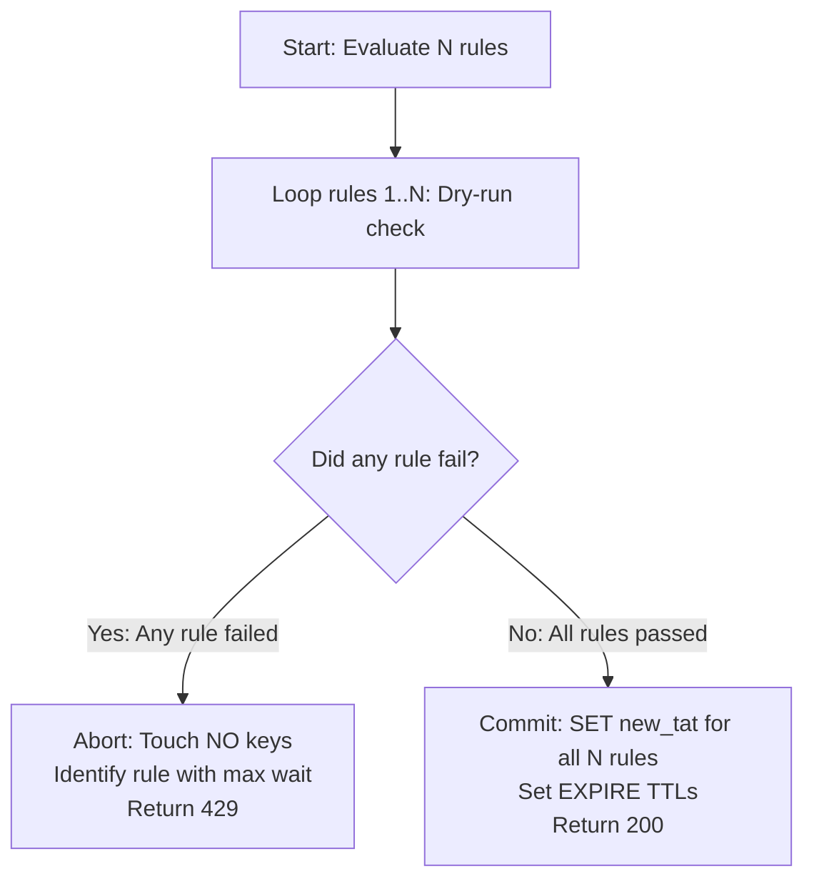
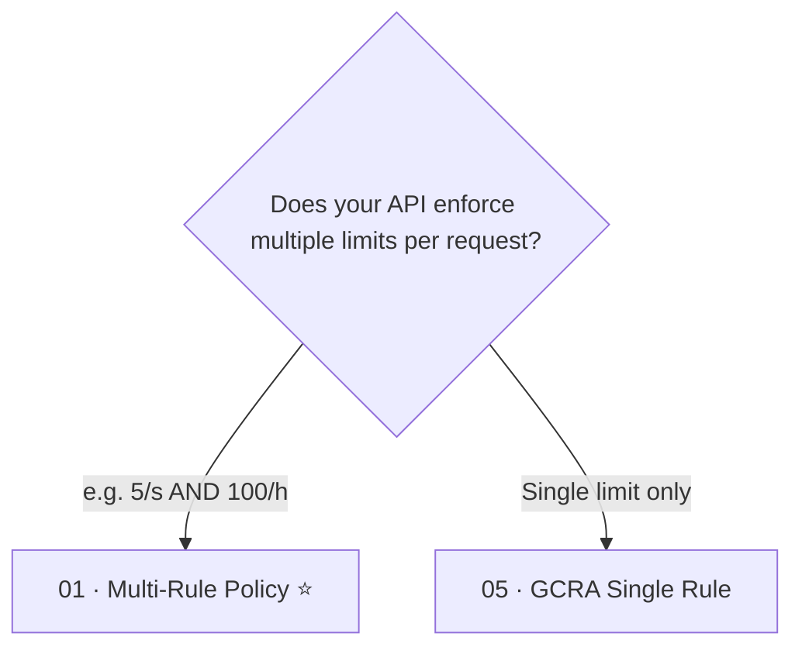

# Multi-Rule Policy  ·  Atomic all-or-nothing rate limiting across multiple rules without quota burn

| | |
|---|---|
| **Engine** | Lua (`multi_rule_gcra.lua`) — Rule 3: all-or-nothing transactions across multiple keys must be evaluated atomically |
| **Redis structure** | Multiple Strings (`rl:{identity}:{rule}:gcra`) all sharing the `{identity}` hash tag |
| **Memory per key** | O(rules): ~60 bytes per active rule |
| **Accuracy** | Exact across all evaluated time horizons |
| **Burst handling** | Independent burst configuration per rule (e.g. 5/s with burst 10 AND 500/hour) |
| **RFC compliance** | Emits standard `RateLimit-*` headers, names `violated_rule`, and returns maximum `Retry-After` |

---

## 1. The Analogy

Imagine entering an amusement park with two passes:
- A **daily pass** that allows 50 rides total.
- A **speed pass** that allows at most 2 rides every 10 minutes.
- At each turnstile, an attendant inspects **both passes at the same time**.
- If your 10-minute speed pass is valid, but your daily pass has 0 rides left, the attendant turns you away: *"Sorry, your daily pass is exhausted"*.
- **Crucially**, the attendant does **not** punch or stamp your 10-minute pass for a ride you never got to take!
- If you were charged for rule A before discovering rule B failed, you would be punished twice.

```text
Incoming Request
    │
    ├─► Rule 1 (Per-sec: 5 req/s)   ── Would pass? ✅
    ├─► Rule 2 (Hourly: 100 req/h)  ── Would pass? ⛔ (Exhausted!)
    │
    ▼
[ATOMIC ALL-OR-NOTHING DECISION]
 ⛔ DENIED: "Hourly rule exhausted"
 🛡️ QUOTA BURN PREVENTED: Rule 1 was CHARGED NOTHING!
```

---

## 2. Who Does What



---

## 3. How It Works (Preventing Quota Burn)

### The Quota Burn Trap in Sequential Code
When a service enforces multiple rate limits (e.g., 5/second AND 100/hour), naive implementations check rules sequentially:

```python
# FLAWED PATTERN:
if not await check_and_charge(sec_rule):
    return 429
if not await check_and_charge(hour_rule): # If this fails...
    return 429 # ...sec_rule was ALREADY charged for a rejected request!
```

If an attacker or busy user exceeds the hourly limit, every subsequent request continues to burn their per-second quota. When the hour finally rolls over, the user is *still* blocked because their per-second bucket was completely drained by rejected requests!

### The Two-Phase Lua Transaction
To enforce atomicity, `multi_rule_gcra.lua` performs a two-phase check:

1. **Dry-Run Phase**:
   - Reads TAT for every rule.
   - Calculates projected `new_tat` and tests if `now >= earliest_allowed`.
   - Records any deficits without writing to Redis.
2. **Decision Phase**:
   - **If any rule fails:** Return `allowed = 0`, name the `violated_rule` with the longest deficit, and calculate the **maximum** `Retry-After`. **Write nothing to Redis.**
   - **If all rules pass:** Commit all `new_tat` values and reset TTLs in a single step.

---

## 4. Redis Data Structure & Hash Tags

To support **Redis Cluster**, all keys belonging to the same identity must hash to the exact same cluster hash slot. We achieve this using Redis hash tags `{identity}`:

```text
KEY 1: rl:{alice}:api_sec:gcra   ───┐
KEY 2: rl:{alice}:api_hour:gcra  ───┼──► Same CRC16({alice}) hash slot!
KEY 3: rl:{alice}:api_day:gcra   ───┘
```

Each key is a single Redis string storing the integer millisecond Theoretical Arrival Time (TAT).

---

## 5. Lua Script Anatomy (Rule 3)



---

## 6. Worked Example (Quota Burn Prevention)

Configuration:
- `sec_rule`: 5 req/s, burst 5
- `hour_rule`: 2 req/h, burst 2

Alice makes 3 rapid requests:

| Request | `sec_rule` Status | `hour_rule` Status | Outcome | Redis `sec_rule` TAT | Redis `hour_rule` TAT |
|---|---|---|---|---|---|
| Request #1 | ✅ (1/5) | ✅ (1/2) | ✅ Allowed | Advanced (+200ms) | Advanced (+1800s) |
| Request #2 | ✅ (2/5) | ✅ (2/2) | ✅ Allowed | Advanced (+200ms) | Advanced (+1800s) |
| Request #3 | ✅ (would be 3/5) | ⛔ (Exceeded 2/2) | ⛔ Denied | **Unchanged!** | **Unchanged!** |

Notice that on Request #3, `sec_rule` was **not** charged. Alice's per-second capacity remains intact.

---

## 7. Decision Tree: When to Use / When to Avoid



### Use it when:
- Tiered API plans (e.g. Free Tier: 5 req/s AND 1,000 req/day).
- Protection against both sudden micro-bursts and prolonged high-volume scraping.
- Preventing quota burn across multiple tiers.

### Avoid it when:
- Each endpoint only has a single rule.

---

## 8. HTTP Contract & Response Headers

### 200 OK (Allowed)
```http
HTTP/1.1 200 OK
Content-Type: application/json
RateLimit-Limit: 5
RateLimit-Remaining: 4
RateLimit-Reset: 1
```

### 429 Too Many Requests (Hourly Limit Violated)
```http
HTTP/1.1 429 Too Many Requests
Content-Type: application/json
Retry-After: 1750
RateLimit-Limit: 5
RateLimit-Remaining: 0
RateLimit-Reset: 1750

{
  "detail": {
    "error": "rate_limited",
    "rule": "api_hour",
    "retry_after_seconds": 1750
  }
}
```

---

## 9. Failure Modes & Edge Cases

| Scenario | Behavior | Mitigation |
|---|---|---|
| **Partial failure in cluster** | Multiple keys across nodes without hash tags fail | Hash tag `{identity}` guarantees all keys reside on the same cluster node |
| **Multiple rules violated** | Caller needs to know how long to wait | Returns `max(retry_after)` so client does not retry too early |
| **Idle key cleanup** | Stale keys consume memory | Individual TTLs computed per rule (`reset_ms + 60s`) |

---

## 10. Concurrency & Race Condition Demo

Run the automated race and quota burn test:

```bash
docker compose run --rm dev python rate_limiters/policies/01_multi_rule/scripts/race_demo.py
```

Expected output:
```text
=================================================================
 RACE & QUOTA BURN DEMO: Naive Sequential vs Atomic Multi-Rule Lua
 Policy: Rule 1 (limit 10) AND Rule 2 (limit 2)
 Concurrency: 50 parallel callers
=================================================================

Engine                         Intended Limit   Actual Allowed   Result
───────────────────────────────────────────────────────────────────────────
Naive (Sequential Check)       2                50               ⛔ LEAKY / BURN
Atomic Multi-Rule Lua          2                2                ✅ EXACT
───────────────────────────────────────────────────────────────────────────
```

---

## 11. See It Work

### 1. Start the service
```bash
make up P=multi-rule
```

### 2. Run the demo script
```bash
./rate_limiters/policies/01_multi_rule/scripts/demo.sh
```

### 3. Observe keys in Redis
```bash
make inspect
```

---

## 12. Code Map

```text
rate_limiters/policies/01_multi_rule/
├── README.md
├── app/
│   ├── config.py                     # Config for multiple rules (sec + hour)
│   ├── controllers/
│   │   └── rate_limit_controller.py  # Evaluates rule lists and sets RFC headers
│   ├── lua/
│   │   └── multi_rule_gcra.lua       # Atomic two-phase all-or-nothing Lua script
│   ├── main.py                       # FastAPI entrypoint, lifespan, health/metrics
│   ├── observability/
│   │   └── metrics.py                # Prometheus latency & decision counters
│   ├── repositories/
│   │   └── redis_repository.py       # Multi-key GCRA executor and key inspector
│   ├── routes/
│   │   ├── debug.py                  # /debug/state inspection
│   │   └── demo.py                   # /demo/limited endpoint with multi-rule dependency
│   ├── schemas/
│   │   ├── decision.py               # Decision with violated_rule
│   │   └── rule.py                   # Rule schema
│   └── services/
│       ├── identity.py               # Header-based identity resolution
│       └── rate_limiter_service.py   # Pure business logic (0 FastAPI/Redis imports)
├── scripts/
│   ├── demo.sh                       # Quick bash test script
│   └── race_demo.py                  # Concurrency and quota burn demo
└── tests/
    ├── test_concurrency_race.py      # 200 parallel callers invariant test
    ├── test_script_invariants.py     # Live Redis test verifying quota burn prevention
    └── test_unit_service.py          # Pure unit tests with in-memory FakeRepository
```

---

## 13. Production Checklist

- [x] All rule keys tagged with `{identity}` for Redis Cluster multi-key atomicity
- [x] All-or-nothing execution: denied requests consume zero quota on any rule
- [x] Maximum `Retry-After` returned across violated rules
- [x] Violated rule name explicitly identified in error response
- [x] Pure service layer without framework or database dependencies
- [x] RFC 6585 and draft-ietf-httpapi-ratelimit headers returned

---

## 14. References

- [IETF RateLimit Header Fields for HTTP](https://datatracker.ietf.org/doc/draft-ietf-httpapi-ratelimit-headers/)
- [RFC 6585: Additional HTTP Status Codes (429)](https://datatracker.ietf.org/doc/html/rfc6585)
- [Redis Cluster Specification: Hash Tags](https://redis.io/docs/latest/operate/oss_and_stack/reference/cluster-spec/#hash-tags)
