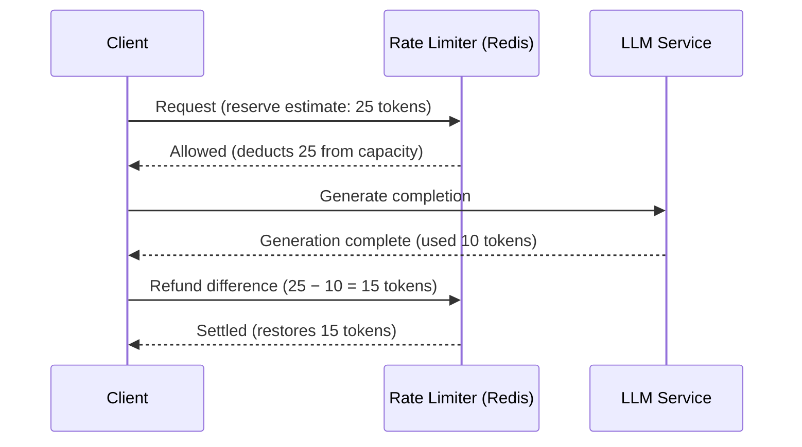

# Policy 03: Weighted Cost & Token Refund

A production rate limiter policy based on the Generic Cell Rate Algorithm (GCRA) supporting non-uniform request costs (`cost > 1`), permanent rejection of impossible requests (`cost > burst`), and dynamic **estimate-then-refund** cost settlements for unknown workloads such as LLM token generation.

---

## 1. Mental Model

Not all API requests impose equal strain on downstream infrastructure:
- A simple `GET /item/123` consumes minimal database and CPU resources ($1\times$).
- A faceted `GET /search?q=...` scans multiple indexes ($5\times$).
- A `POST /reports/export` invokes heavy analytical joins ($15\times$).
- An LLM streaming response generates an unknown number of tokens whose cost is only known *after* completion.

```
                         Incoming Request
                                │
               ┌────────────────┴────────────────┐
               ▼                                 ▼
          Static Cost                      Dynamic Cost
      (e.g., Export = 15)              (LLM Token Generation)
               │                                 │
     Cost > Burst Check?                1. Reserve estimate (e.g., 25)
   ┌───────────┴───────────┐                     │
   ▼                       ▼            2. Execute generation (used 10)
Exceeds Burst          Admissible                │
  (422 Fatal)        (Evaluate GCRA)    3. Refund unused tokens (15)
                                        (Cap TAT at full capacity)
```

---

## 2. The Impossible Request: `cost > burst`

In token bucket and GCRA algorithms, `burst` represents the maximum instantaneous capacity.
If a caller requests a cost greater than the burst capacity (`cost > burst`):
- **The Wrong Behavior**: Returning `429 Too Many Requests` with a `Retry-After: 30` header. The client waits, retries, and is rejected again indefinitely, generating useless retry loops and log spam.
- **The Right Behavior**: Returning a permanent client error (`HTTP 422 Unprocessable Entity` or `HTTP 400 Bad Request`) indicating the request is structurally too large to ever be admitted.

In `app/lua/weighted_gcra.lua`:
```lua
if cost > burst then
    -- Return code -1 signals permanent rejection (non-retryable)
    return {-1, 0, 0, 0, burst}
end
```

---

## 3. Dynamic Cost: Estimate-Then-Refund Pattern

When integrating with Large Language Models (LLMs) or complex search jobs, the exact token count is impossible to know upfront.



### The Settlement Invariant: Cannot Exceed Capacity
If a client over-refunds (or attempts to refund more tokens than were consumed), naive addition would give the client free tokens beyond their burst ceiling!

In `app/lua/refund_gcra.lua`, GCRA enforces:
$$\text{new\_tat} = \max(\text{now\_ms}, \text{tat} - (\text{T\_ms} \times \text{refund\_cost}))$$
Because full capacity corresponds to $\text{TAT} \le \text{now\_ms}$, pulling $\text{TAT}$ earlier than $\text{now\_ms}$ is strictly forbidden. The bucket is cleanly capped at burst capacity.

---

## 4. Redis Key Schema

```
rl:{<identity>}:weighted_gcra
```
- **Type**: `String` storing integer TAT in Unix milliseconds.
- **TTL**: `max(60, ceil(reset_ms / 1000) + 60)` seconds.

---

## 5. HTTP Contract & Headers

### Allowed Response (200 OK)
```http
HTTP/1.1 200 OK
RateLimit-Limit: 20
RateLimit-Remaining: 15
RateLimit-Reset: 3
X-RateLimit-Cost: 5
```

### Exceeds Burst (422 Unprocessable Entity - Never Retry)
```http
HTTP/1.1 422 Unprocessable Entity
Content-Type: application/json

{
  "detail": {
    "error": "cost_exceeds_burst",
    "message": "Requested cost 100 permanently exceeds burst capacity 20.",
    "cost": 100,
    "burst": 20
  }
}
```

### Rate Limited (429 Too Many Requests - Retryable)
```http
HTTP/1.1 429 Too Many Requests
Retry-After: 4
RateLimit-Limit: 20
RateLimit-Remaining: 0
RateLimit-Reset: 4

{
  "detail": {
    "error": "rate_limited",
    "rule": "weighted_gcra",
    "retry_after_seconds": 4,
    "cost": 15
  }
}
```

---

## 6. Endpoints

| Method | Path | Cost | Description |
|---|---|---|---|
| `GET` | `/demo/limited` | 1 | Default contract endpoint |
| `GET` | `/demo/query` | 1 | Cheap search query |
| `GET` | `/demo/report` | 5 | Medium analytical report |
| `GET` | `/demo/export` | 15 | Heavy batch export |
| `GET` | `/demo/oversized` | 100 | Impossible request (returns 422) |
| `POST` | `/demo/llm` | dynamic | Reserves estimated tokens, runs mock generation, refunds difference |
| `GET` | `/debug/state` | — | Redis key inspection |

---

## 7. Quickstart

```bash
# Start Redis and weighted-cost service
docker compose --profile weighted-cost up --build -d weighted-cost

# Health check
curl http://localhost:8203/health
```

---

## 8. See It Work

### 1. Live Scenarios Demo
```bash
./rate_limiters/policies/03_weighted_cost/scripts/demo.sh
```

### 2. Concurrency Race Demo
```bash
docker compose run --rm dev python rate_limiters/policies/03_weighted_cost/scripts/race_demo.py
```

### 3. Inspect Redis State
```bash
curl -s "http://localhost:8203/debug/state" | jq
```

---

## 9. Code Tour

- [`app/lua/weighted_gcra.lua`](app/lua/weighted_gcra.lua): GCRA admission script with `cost > burst` permanent rejection check.
- [`app/lua/refund_gcra.lua`](app/lua/refund_gcra.lua): Cost refund script with capacity bounding invariant.
- [`app/controllers/rate_limit_controller.py`](app/controllers/rate_limit_controller.py): Translates requests into weighted checks and handles `reserve_and_settle`.
- [`app/routes/demo.py`](app/routes/demo.py): Exposes queries, reports, exports, oversized requests, and mock LLM endpoint.
- [`tests/test_script_invariants.py`](tests/test_script_invariants.py): Tests real Redis invariants: permanent rejection of `cost > burst`, refund capacity capping, and LLM reservation settlement.

---

## 10. Observability & Metrics

Prometheus metrics exposed at `/metrics`:
- `rl_decisions_total{limiter="weighted_cost", outcome="allowed|denied|rejected", status="allowed|rate_limited|exceeds_burst|reserved"}`
- `rl_latency_seconds{limiter="weighted_cost"}`
- `rl_refunds_total{limiter="weighted_cost"}`
